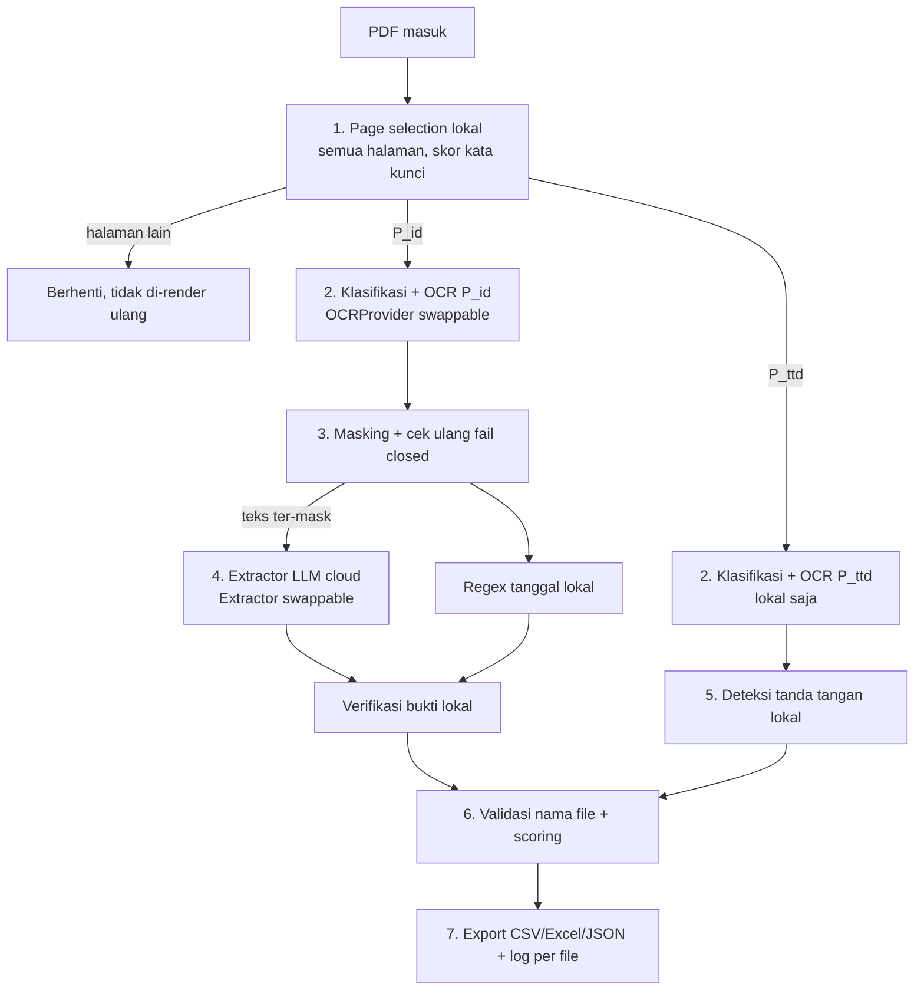

# PRD & RFC: Ekstraksi Kontrak Karyawan dari PDF

Oct 23, 2026 · @Alpha5

## 1. Latar belakang dan tujuan

Sistem ini membaca PDF kontrak karyawan dari berbagai vendor dan mengeluarkan tiga field per file: nama karyawan, masa kontrak, dan status tanda tangan karyawan. Gaji dan informasi rahasia lain tidak pernah keluar dari mesin lokal; yang keluar hanya teks halaman identitas yang sudah di-mask.

Kondisi yang harus ditangani:

- Format kontrak berbeda per vendor, tidak ada template tetap.
- File selalu PDF, tetapi isinya bisa native (Word → PDF), scan/foto, atau hybrid (foto ditempel ke Word lalu dikonversi).
- Nama karyawan dan masa kontrak juga tertulis di nama file dengan pola `Nama Karyawan - Masa Kontrak`, dapat dipakai sebagai pembanding.
- Kontrak memuat gaji dan tunjangan; satu-satunya data yang boleh keluar dari mesin lokal adalah teks halaman identitas yang sudah di-mask. Halaman tanda tangan dan halaman lain diproses sepenuhnya lokal.

Tujuan proyek:

1. Ekstraksi nama karyawan dan masa kontrak dengan akurasi yang bisa diukur di test set berlabel.
2. Penentuan status tanda tangan karyawan dengan tiga keluaran: signed, unsigned, uncertain.
3. Data minimization yang bisa dibuktikan lewat log halaman per file.
4. Hasil yang bisa dipercaya untuk dipakai langsung (auto-pass) atau ditinjau manusia (review queue) berdasarkan confidence score.

## 2. Ruang lingkup

Proyek ini berhenti di tiga field dan status review; verifikasi keaslian tanda tangan dan ekstraksi klausul lain di luar scope.

Dalam scope:

- Input PDF native, scan/foto, dan hybrid, dari vendor mana pun.
- Ekstraksi nama karyawan, tanggal mulai, tanggal selesai (atau durasi bila dokumen hanya menyebut durasi).
- Status tanda tangan karyawan: signed, unsigned, uncertain.
- Pembandingan hasil ekstraksi dengan nama file (fuzzy match nama, normalisasi tanggal).
- Confidence score per field dan review queue untuk kasus ragu.
- Log per file: halaman mana yang diproses, komponen mana yang menerimanya.
- Komponen OCR yang bisa ditukar antara lokal dan cloud, dan extractor LLM yang bisa ditukar antar penyedia cloud, tanpa mengubah pipeline.

Di luar scope:

- Ekstraksi gaji, tunjangan, atau klausul kontrak lainnya.
- Verifikasi bahwa tanda tangan benar milik karyawan tersebut (forensik tanda tangan).
- Status tanda tangan pihak perusahaan, stempel, dan materai.
- Validasi kriptografis e-signature; cukup dideteksi ada atau tidak.
- Perbaikan, pengeditan, atau penamaan ulang file PDF.
- Antarmuka review khusus pada fase pertama; review memakai spreadsheet hasil export.

## 3. Requirement fungsional

Sepuluh requirement di bawah ini mendefinisikan perilaku sistem; FR-1 sampai FR-7 wajib ada di rilis pertama.

| ID | Requirement | Prioritas |
| --- | --- | --- |
| FR-1 | Menerima satu file atau satu folder PDF, memproses per file, dan tidak gagal total karena satu file rusak. | Must |
| FR-2 | Menentukan halaman identitas dan halaman tanda tangan secara lokal; halaman lain tidak di-render, di-OCR, atau dikirim ke mana pun. | Must |
| FR-3 | Mengekstrak nama karyawan, tanggal mulai, tanggal selesai dari halaman identitas; mengembalikan null bila tidak ditemukan, tidak menebak. | Must |
| FR-4 | Mendeteksi tanda tangan karyawan di halaman tanda tangan dengan keluaran signed, unsigned, atau uncertain. | Must |
| FR-5 | Membandingkan nama dan masa kontrak hasil ekstraksi dengan nama file; mencatat cocok, mirip, atau tidak cocok. | Must |
| FR-6 | Menghasilkan confidence score per field dan keputusan auto-pass atau review per file. | Must |
| FR-7 | Menulis log per file: jumlah halaman, halaman terpilih, komponen yang menerima tiap halaman, alasan keputusan. | Must |
| FR-8 | Mengekspor hasil ke CSV/Excel dan JSON dengan skema tetap. | Should |
| FR-9 | Mengenali e-signature pada PDF native (field tanda tangan atau gambar di area tanda tangan). | Should |
| FR-10 | Menandai mismatch antara nama file dan isi dokumen sebagai temuan tersendiri, bukan sekadar error ekstraksi. | Could |

## 4. Requirement non-fungsional

Privasi adalah constraint utama. Dalam konfigurasi default, satu-satunya data yang meninggalkan mesin lokal adalah teks `P_id` yang sudah di-mask, dikirim ke LLM cloud. OCR cloud adalah opsi non-default yang mengirim gambar `P_id` mentah sebelum masking (termasuk NIK dan alamat) dan hanya aktif dengan persetujuan tertulis terpisah; halaman tanda tangan dan halaman lain tidak pernah keluar dalam konfigurasi apa pun.

| Kategori | Requirement | Target awal |
| --- | --- | --- |
| Privasi | Halaman selain identitas dan tanda tangan tidak di-render ke gambar dan tidak di-OCR di luar tahap page selection lokal. | 0 halaman bocor, dibuktikan dari log |
| Privasi | Angka berpola rupiah, nomor rekening, dan deret ≥ 10 digit (termasuk yang dipisah spasi, strip, atau titik) di-mask sebelum teks dikirim ke LLM; bila pemeriksaan ulang masih menemukan deret angka, pengiriman dibatalkan (fail closed). | 100% ter-mask di test set dan korpus kebocoran |
| Privasi | Halaman tanda tangan diproses sepenuhnya lokal tanpa fallback ke model eksternal; kasus ragu masuk review manusia. | 0 byte halaman tanda tangan keluar |
| Privasi | Gambar hasil render dan teks OCR dihapus setelah file selesai diproses; hanya hasil akhir dan log yang disimpan. | Retensi 0 hari untuk data antara |
| Privasi | Untuk LLM cloud, dan OCR cloud bila dipakai: tier enterprise, no-training, zero atau limited retention, DPA ditandatangani, region Jakarta bila tersedia. OCR cloud nonaktif secara default lewat flag konfigurasi, karena mengirim gambar P\_id mentah sebelum masking, dan setiap aktivasinya dicatat di log per file. | Disetujui tertulis oleh client |
| Akurasi | Nama karyawan, setelah normalisasi, sama persis dengan label. | ≥ 95% di test set |
| Akurasi | Tanggal mulai dan selesai sama persis dengan label. | ≥ 95% di test set |
| Akurasi | Kontrak yang belum ditandatangani tidak dilabeli signed. | Recall unsigned ≥ 98% |
| Akurasi | Kontrak yang dilabeli signed memang ditandatangani. | Precision signed ≥ 98% |
| Operasional | Proporsi file yang lolos tanpa review manusia. | ≥ 80% |
| Performa | Waktu proses per file di mesin tanpa GPU, termasuk OCR lokal dua halaman. | ≤ 30 detik |
| Portabilitas | OCR diganti antara implementasi lokal dan cloud, dan LLM diganti antar penyedia cloud, lewat konfigurasi tanpa mengubah kode pipeline. | Satu flag konfigurasi |
| Auditabilitas | Setiap keputusan per file bisa ditelusuri ke halaman, komponen, dan skor yang menghasilkannya. | Log JSON per file |

Angka target di atas adalah usulan awal untuk disepakati dengan client setelah test set tersedia; yang tidak boleh turun adalah baris privasi.

## 5. Success metrics dan acceptance criteria

Proyek dinyatakan diterima bila semua kriteria di bawah terpenuhi pada test set berlabel yang disepakati bersama client, bukan pada sample pilihan tim.

| Metrik | Cara ukur | Kriteria terima |
| --- | --- | --- |
| Page selection recall | Halaman identitas dan halaman tanda tangan yang dipilih sama dengan label manusia | ≥ 95% file |
| Akurasi nama | Exact match setelah normalisasi (huruf kecil, tanpa gelar dan tanda baca) | ≥ 95% |
| Akurasi periode | Tanggal mulai dan selesai keduanya exact match | ≥ 95% |
| Recall unsigned | Dari semua kontrak berlabel unsigned, berapa yang tidak dilabeli signed oleh sistem | ≥ 98% |
| Precision signed | Dari semua yang dilabeli signed oleh sistem, berapa yang benar | ≥ 98% |
| Auto-pass rate | File dengan keputusan auto tanpa review | ≥ 80% |
| Kesalahan pada auto-pass | Field salah pada file yang lolos auto | ≤ 1% |
| Kebocoran halaman | Halaman di luar identitas dan tanda tangan yang tercatat dikirim ke komponen non-lokal | 0 |
| Waktu per file | Median di mesin tanpa GPU | ≤ 30 detik |

Metrik yang diprioritaskan bila harus memilih: recall unsigned dan kesalahan pada auto-pass. Kontrak yang belum ditandatangani tetapi dilaporkan signed adalah kegagalan paling mahal bagi HR, lebih mahal daripada file yang masuk review.

## 6. Asumsi, risiko, dan pertanyaan terbuka

Enam pertanyaan terbuka di bawah harus terjawab sebelum minggu kedua implementasi; dua di antaranya (kebijakan cloud dan lampiran setelah tanda tangan) mengubah desain.

Asumsi kerja:

- Identitas karyawan berada di halaman 1; masa kontrak berada di pasal awal, biasanya masih di halaman 1 tetapi bisa berlanjut ke halaman 2 pada vendor dengan pembukaan panjang.
- Blok tanda tangan karyawan berada di satu halaman di bagian akhir dokumen dan memuat nama karyawan tercetak, tetapi posisi vertikalnya tidak tetap: pada sampel berada di 44–54% tinggi halaman (Sampel A dan B) dan 65–69% (Sampel D).
- Dokumen berbahasa Indonesia, sebagian bercampur Inggris.
- Nama file dibuat manusia dan bisa salah; ia pembanding, bukan kebenaran.
- Tanda tangan karyawan berupa tanda tangan basah pada scan, atau e-signature pada PDF native; pada sampel native wujudnya anotasi Stamp (iOS Markup), anotasi Ink, atau gambar kecil, bukan field tanda tangan digital.

| Risiko | Dampak | Mitigasi |
| --- | --- | --- |
| Vendor baru dengan layout tak terduga | Page selection salah halaman, ekstraksi kosong | Skor jangkar berbasis kata kunci, bukan posisi; ambang rendah → review, bukan tebakan |
| Kualitas foto buruk (miring, gelap, blur) | OCR lokal gagal, nama tidak terbaca | Preprocessing deskew dan threshold; fallback OCR kedua; terakhir review |
| Client melarang cloud | Ekstraksi LLM tidak bisa dijalankan | LLM lokal tidak dipakai atas keputusan client, jadi ajukan paket syarat enterprise (no-training, retensi nol, DPA, region Jakarta) sejak Fase 0; bila tetap ditolak, scope ekstraksi menjadi pra-isi untuk diverifikasi manusia |
| OCR cloud aktif tanpa disadari | Gambar P\_id mentah (NIK, alamat) keluar sebelum masking | Flag nonaktif secara default, butuh persetujuan tertulis terpisah, setiap aktivasi tercatat di log per file |
| Stempel atau tulisan tangan di area tanda tangan | False positive signed | Filter komponen berdasarkan bentuk dan ukuran; zona abu-abu → uncertain |
| Tanda tangan native berupa anotasi atau vektor (Fill & Sign) | False unsigned lolos auto-pass | Cek anotasi, gambar, vektor, dan rasterisasi ROI; unsigned native memakai confidence normal, bukan tinggi |
| Gaji ada di halaman identitas | Data sensitif ikut ke LLM | Masking rupiah dan deret angka dengan pemisah diabaikan, pemeriksaan ulang fail closed, diuji dengan korpus kebocoran |
| Gemini free tier dipakai pada data asli | Melanggar NFR privasi (no-training) | Gemini hanya lewat Vertex AI; free tier dibatasi ke data sintetis saat development |
| Dependency berlisensi terlarang (AGPL, GPL, LGPL) | Melanggar kebijakan lisensi perusahaan, rilis tertahan | PyMuPDF (AGPL-3.0) diganti pypdfium2, pdfplumber, dan pypdf; versi di-pin dan lisensi dipindai setiap perubahan dependency |
| Nama file tidak mengikuti pola `Nama Karyawan - Masa Kontrak` | Sinyal pembanding hilang; bila banyak, auto-pass rate turun | Ditandai `filename_nonstandard` dan dinilai kuning; HR memeriksa kepatuhan pola lewat quick win di Bagian 14 sebelum batch dijalankan |
| Paraf dan coretan Ink di halaman isi | Anotasi salah dibaca sebagai tanda tangan karyawan | Anotasi hanya dihitung bila berpotongan dengan ROI karyawan |
| Nama file dan isi tidak cocok karena file salah simpan | Dianggap error ekstraksi | Mismatch dilaporkan sebagai temuan tersendiri (FR-10) |
| Test set terlalu kecil atau tidak mewakili semua vendor | Target akurasi tidak bisa dipercaya | Minimal 50 file, semua vendor dan ketiga jenis PDF terwakili |

Pertanyaan terbuka:

- [ ] Berapa volume file, dan apakah sekali jalan atau berkelanjutan?
- [ ] Apakah ada kontrak dengan lampiran setelah halaman tanda tangan?
- [ ] Apakah client mengizinkan OCR atau LLM cloud dengan syarat enterprise, dan untuk komponen mana?
- [ ] Bagaimana persis bagian masa kontrak ditulis di nama file? Sebagian terjawab: file produksi memakai pola `Nama Karyawan - Masa Kontrak`; format tanggal di bagian masa kontrak (rentang tanggal panjang, singkatan bulan, atau durasi) masih perlu dikonfirmasi. Nama file sampel belum mengikuti pola ini dan tidak dipakai sebagai acuan format.
- [ ] Apakah ada kontrak berbahasa Inggris penuh?
- [ ] Berapa lama hasil ekstraksi dan log boleh disimpan, dan di mana?

Temuan dari empat file sampel (23 Okt 2026), dianalisis lokal dari struktur PDF tanpa membaca isi teks:

| File | Jenis | Tanda tangan karyawan (hlm 5) | Tanda tangan perusahaan | Objek lain |
| --- | --- | --- | --- | --- |
| Sampel A (nama file `Nama 1jan-31mar24`) | Native (PDF24, ditandatangani di iOS), 5 halaman | Anotasi Stamp, kolom kanan, 44–54% tinggi halaman | Vektor 79 kurva, kolom kiri | Ink di hlm 3 |
| Sampel B (nama file `Nama 1jan-31mar24`) | Native (PDF24), template sama dengan Sampel A, 5 halaman | Gambar kecil, kolom kanan, 46–54% | Vektor 79 kurva, kolom kiri | Ink di hlm 3 |
| Sampel C (nama file `Nama` saja) | Scan, satu gambar 99% per halaman, 5 halaman | Perlu OCR | Perlu OCR | Ink di hlm 2 |
| Sampel D (nama file `Nama` saja) | Native (iLovePDF), 5 halaman | Anotasi Ink, kolom kanan, 65–69% | Dua gambar bertumpuk (tanda tangan dan stempel), kolom kiri | Paraf Ink di pojok kiri bawah setiap halaman, Ink di hlm 2 |

Konsekuensi desain yang sudah dimasukkan ke bagian terkait:

- Cakupan bbox teks halaman native hanya 8–37%, sehingga klasifikasi native tidak memakai ambang cakupan teks (Bagian 9).
- Blok tanda tangan tidak selalu di bagian bawah halaman; jangkar memakai zona penutup, bukan persentase tinggi halaman (Bagian 8 dan 11).
- `Pihak Pertama` dan `Pihak Kedua` muncul berulang di isi pasal, sehingga kata kunci tanda tangan hanya dihitung di zona penutup (Bagian 8).
- Anotasi Ink juga muncul sebagai paraf dan coretan di halaman isi, termasuk pada file scan; hanya anotasi di ROI karyawan yang dihitung (Bagian 11).
- Tanda tangan perusahaan bisa berupa vektor; pemeriksaan vektor dibatasi ke ROI karyawan (Bagian 11).
- Nama file sampel belum mengikuti pola produksi `Nama Karyawan - Masa Kontrak` (dua tanpa periode, dua dengan format rapat `1jan-31mar24`), sehingga parser nama file diuji dengan nama sintetis, bukan nama file sampel (Bagian 12).
- Belum ada sampel hybrid; test set Fase 0 wajib menambahkannya.

## 7. Arsitektur dan alur pipeline



Hanya panah `S3 → S4` yang melewati batas mesin lokal dalam konfigurasi default. OCR cloud, bila diaktifkan, berada di dalam `S2A` dan hanya untuk `P_id`.

Seluruh file dibaca hanya di tahap page selection lokal; setelah itu dua halaman yang hidup berpisah jalur. Dalam konfigurasi default, satu-satunya data yang keluar adalah teks `P_id` yang sudah di-mask (jalur kiri) ke LLM cloud; OCR cloud di jalur yang sama nonaktif kecuali disetujui terpisah. Halaman tanda tangan tidak pernah keluar.

## 8. Tahap 1: Page selection lokal

Semua halaman dibaca di mesin lokal hanya untuk memilih `P_id` (identitas dan periode, satu atau dua halaman) dan `P_ttd` (tanda tangan). Halaman lain berhenti di sini dan tidak pernah di-render ulang.

Langkah:

1. Buka PDF dengan pypdfium2. Untuk setiap halaman ambil teks dari text layer (`page.get_textpage().get_text_bounded()`).
2. Bila teks < 50 karakter, render halaman ke grayscale 150 dpi dan jalankan Tesseract lokal (`ind+eng`) hanya untuk mendapatkan teks kasar. Resolusi rendah cukup karena tujuannya skoring, bukan ekstraksi.
3. Hitung empat skor per halaman dari kata kunci dan pola di bawah: skor identitas, skor periode, skor tanda tangan, skor sensitif.
4. Tambahkan bonus bila nama dari nama file ditemukan secara fuzzy (rapidfuzz `partial_ratio` ≥ 85) di halaman itu: bonus besar untuk skor tanda tangan bila nama berada di zona penutup halaman (definisi di bawah tabel), bonus kecil untuk skor identitas.
5. `P_id` = halaman dengan skor identitas tertinggi di antara tiga halaman pertama. Bila halaman dengan skor periode tertinggi berbeda dan masih di tiga halaman pertama, halaman itu ikut menjadi `P_id` kedua; `P_id` maksimal dua halaman. `P_ttd` = halaman dengan skor tanda tangan tertinggi, dicari dari halaman terakhir ke depan, maksimal lima halaman.
6. Bila skor tertinggi di bawah ambang, file masuk review dengan alasan `page_selection_ambiguous` dan tidak melanjutkan ke tahap cloud mana pun.
7. Tulis manifest: nomor halaman terpilih, skor, halaman yang ditandai sensitif, jumlah halaman total.

| Skor | Sinyal yang menambah skor |
| --- | --- |
| Identitas | `perjanjian kerja`, `perjanjian kerja waktu tertentu`, `PKWT`, `PKWTT`, `nama`, `NIK`, `No. KTP`, `tempat/tanggal lahir`, `jenis kelamin`, `selanjutnya disebut`, `Tenaga Kerja`, `Pihak Kedua`, `Para Pihak`, blok label-nilai `Nama : …` yang diikuti `NIK` atau tanggal lahir |
| Periode | `jangka waktu`, `berlaku efektif mulai tanggal`, `dimulai sejak tanggal`, `berakhir dengan sendirinya pada tanggal`, `sampai dengan tanggal`, `s/d`, dua pola tanggal dalam satu kalimat (`1 Januari 2024`, `01/01/2024`, `29-12-2023`) |
| Tanda tangan | `Pihak Pertama` dan `Pihak Kedua`, atau `IMECON`/nama perusahaan dan `Tenaga Kerja`, muncul berdekatan di zona penutup; `tanda tangan`, `menyetujui`, `materai`, `Jakarta, 1 Januari 2024` di zona penutup; nama karyawan di zona penutup; rasio teks rendah dengan area kosong besar setelah paragraf terakhir |
| Sensitif | `gaji`, `upah`, `tunjangan`, `THR`, `bonus`, `BPJS`, `potongan`, `Rp`, `rekening`, deret angka ≥ 10 digit |

Zona penutup adalah area dari kalimat penutup kontrak (`Demikian perjanjian ini`, `dibuat dan ditandatangani`, atau baris tempat-tanggal seperti `Jakarta, 1 Januari 2024`) sampai batas bawah halaman; bila kalimat penutup tidak ditemukan, zona dimulai dari ujung bawah paragraf isi terakhir. Posisi absolut tidak dipakai karena pada sampel blok tanda tangan berada di 44–54% tinggi halaman pada satu vendor dan 65–69% pada vendor lain. Kata kunci tanda tangan hanya dihitung di zona penutup, karena `Pihak Pertama` dan `Pihak Kedua` juga muncul berulang di isi pasal.

Skor sensitif tidak menggugurkan halaman identitas; ia mengaktifkan masking di Tahap 3 dan dicatat di log. Ambang skor dikalibrasi di test set, bukan ditetapkan di awal.

Mode hemat yang bisa dipakai bila volume besar: jalankan OCR skoring hanya pada tiga halaman pertama dan lima halaman terakhir. Halaman tengah tidak dibaca sama sekali, karena tidak pernah menjadi kandidat `P_id` atau `P_ttd`.

## 9. Tahap 2: Klasifikasi halaman dan OCR

Hanya `P_id` dan `P_ttd` yang masuk tahap ini. Tiap halaman diklasifikasikan native, scan, atau hybrid, lalu dibaca lewat tangga OCR yang berhenti di anak tangga pertama yang cukup baik.

Klasifikasi per halaman:

| Jenis | Ciri | Cara baca |
| --- | --- | --- |
| Native | Text layer ≥ 50 karakter dan tidak ada satu gambar pun yang menutupi > 70% halaman; cakupan bbox teks tidak dipakai karena halaman native di sampel hanya 8–37% | Text layer langsung, dengan koordinat kata dari pdfplumber `extract_words()` |
| Scan | Text layer kosong atau hampir kosong; satu gambar menutupi > 70% halaman | Render 300 dpi → OCR |
| Hybrid | Ada text layer (header/footer dari Word) tetapi gambar menutupi > 70% halaman | Perlakukan sebagai scan; text layer diabaikan |

Halaman yang tidak masuk ketiga kategori (teks < 50 karakter tanpa gambar dominan, misalnya halaman hampir kosong) dicatat `page_unclassified` dan file masuk review.

Tangga OCR untuk halaman scan dan hybrid:

1. Preprocessing dengan OpenCV: grayscale, deskew berdasarkan sudut garis teks dominan, adaptive threshold, penghapusan bayangan dengan background subtraction untuk foto HP.
2. Tesseract 5 lokal, bahasa `ind+eng`, mode `--psm 6`, keluaran `image_to_data` agar tiap kata punya bounding box dan confidence.
3. Uji kualitas: mean confidence kata ≥ 70, dan nama dari nama file ditemukan fuzzy di `P_id`. Lolos → selesai.
4. Gagal → PaddleOCR lokal, yang lebih tahan terhadap foto miring dan kontras rendah. Uji kualitas yang sama.
5. Masih gagal → secara default file masuk review dengan alasan `ocr_low_confidence`. Dalam konfigurasi default tidak ada komponen cloud di tangga ini.
6. Opsi non-default `ocr.cloud_fallback: true`: OCR cloud (Azure Document Intelligence, Google Document AI, atau AWS Textract) untuk `P_id` saja. Opsi ini mengirim gambar halaman mentah sebelum masking, termasuk NIK dan alamat, sehingga hanya boleh diaktifkan dengan persetujuan tertulis terpisah dari client, dan setiap pemakaiannya dicatat di log per file. `P_ttd` tidak pernah masuk opsi ini.

Semua implementasi OCR memenuhi satu interface yang sama sehingga pipeline tidak tahu mana yang dipakai:

```python
class OCRProvider(Protocol):
    def read(self, image: np.ndarray) -> list[Word]: ...

@dataclass
class Word:
    text: str
    bbox: tuple[int, int, int, int]  # x0, y0, x1, y1 dalam piksel
    conf: float                      # 0..1
```

Teks native dari pdfplumber dibungkus ke struktur `Word` yang sama, sehingga Tahap 3 dan Tahap 4 bekerja pada daftar kata berkoordinat tanpa peduli sumbernya. Koordinat ini yang dipakai Tahap 4 untuk menemukan area tanda tangan.

## 10. Tahap 3: Masking dan ekstraksi nama & periode

Teks `P_id` di-mask dulu, lalu dikirim ke extractor yang mengembalikan JSON dengan skema tetap dan bukti kutipan. Nama yang tidak ditemukan di teks sumber ditolak, bukan diterima.

Masking sebelum teks keluar dari mesin lokal:

| Pola | Contoh | Hasil |
| --- | --- | --- |
| Nominal rupiah | `Rp 7.500.000,-`, `Rp7.500.000`, `IDR 7,500,000` | `Rp [REDACTED]` |
| Angka dengan satuan uang | `7,5 juta`, `tujuh juta lima ratus ribu rupiah` | `[REDACTED]` |
| Deret ≥ 10 digit, pemisah diabaikan | `3171012345670001`, `3171 0123 4567 0001`, `0812-3456-7890`, `+62 812 3456 7890`; regex `(?<!\d)(?:\d[\s.\-]?){9,}\d(?!\d)`, dijalankan setelah tanggal numerik dilindungi | `[REDACTED-ID]` |
| Baris dengan kata kunci sensitif | baris yang memuat `gaji`, `upah`, `tunjangan`, `THR`, `bonus` | seluruh baris diganti `[REDACTED-LINE]` |
| Baris identitas yang tidak dibutuhkan | baris berlabel `Alamat`, `Telepon`, `Tempat/Tgl Lahir`, `Tempat dan tanggal lahir` | seluruh baris diganti `[REDACTED-LINE]`; label `Nama`, `Jabatan`, `NIK` dipertahankan agar LLM bisa membedakan blok karyawan dari blok perwakilan perusahaan |

Tanggal kalender valid dengan tahun empat digit (`\d{1,2}[/.\-]\d{1,2}[/.\-]\d{4}`) dikenali lebih dulu dan dikecualikan dari pencocokan deret digit, karena dua tanggal yang hanya dipisah satu spasi (`01.01.2024 31.03.2024`) akan menyatu menjadi 16 digit dan ikut ter-mask; satu tanggal paling panjang delapan digit. Nama tidak tersentuh. Setelah masking, teks diperiksa ulang dengan aturan yang sama (deret digit dengan pengecualian tanggal, ditambah pola rupiah). Pemisah tidak dihapus secara global, karena itu akan menggabungkan tanggal berdampingan seperti `01-01-2024 - 31-03-2024` menjadi deret 16 digit dan memicu `mask_leak` palsu. Bila masih ada, pengiriman ke LLM dibatalkan dan file masuk review dengan alasan `mask_leak` (fail closed). Masking diuji dengan korpus kebocoran, yaitu baris sintetis berisi NIK, rekening, nomor HP, dan gaji dalam berbagai format pemisah, yang dijalankan di pytest pada setiap perubahan; hasil per file dicatat di log sebagai jumlah pola yang diganti.

Skema keluaran extractor:

```json
{
  "nama_karyawan": "string | null",
  "tanggal_mulai": "YYYY-MM-DD | null",
  "tanggal_selesai": "YYYY-MM-DD | null",
  "durasi_bulan": "int | null",
  "bukti": {"nama": "kutipan ≤ 15 kata", "periode": "kutipan ≤ 15 kata"},
  "confidence": "0.0 - 1.0"
}
```

Aturan prompt untuk LLM:

- Ambil nama pihak karyawan, bukan perwakilan perusahaan, direktur, atau saksi. Sebutannya berbeda per vendor: `Tenaga Kerja`, `PIHAK KEDUA`, `Pekerja`, `Karyawan`; karyawan adalah pihak yang bertindak untuk dan atas nama sendiri, bukan untuk dan atas nama PT.
- Blok `Nama :` pertama di halaman bisa milik perwakilan perusahaan (biasanya disertai `Jabatan` dan alamat kantor). Blok karyawan ditandai `NIK` atau `No. KTP` dan tanggal lahir.
- Tanggal penandatanganan di paragraf pembuka (sering ditulis dalam kata, misalnya `Dua Puluh Sembilan bulan Desember tahun Dua Ribu Dua Puluh Tiga`) dan tanggal lahir bukan periode kontrak. Periode diambil dari kalimat yang memuat `dimulai`, `berlaku efektif`, `berakhir`, atau `sampai dengan`.
- Bulan dalam bahasa Indonesia dan Inggris (`Juli` dan `July`) dinormalisasi ke angka; tahun dua digit ditolak sebagai null.
- Bila dokumen hanya menyebut durasi (`12 bulan`), isi `durasi_bulan` dan biarkan `tanggal_selesai` null; pipeline menghitungnya dari tanggal mulai.
- Tidak boleh menebak. Field yang tidak ada di teks dikembalikan null.
- Teks yang dikirim dibatasi ke `P_id` saja, maksimal 4.000 karakter per halaman, karena identitas dan pasal periode hampir selalu di bagian awal.

Verifikasi lokal setelah LLM menjawab: `bukti.nama` harus ditemukan di teks sumber (fuzzy ≥ 90), tanggal yang diekstrak harus muncul dalam salah satu bentuk di teks sumber. Gagal verifikasi → confidence dipaksa turun ke review.

Jalur paralel tanpa LLM yang selalu jalan: regex tanggal (`\d{1,2}\s+(Januari|…|Desember|January|…|December)\s+\d{4}` dan `\d{2}[/-]\d{2}[/-]\d{4}`) mengumpulkan tanggal di `P_id`, tetapi hanya yang berada dalam 120 karakter setelah kata jangkar `mulai`, `dimulai`, `berlaku efektif`, `berakhir`, `sampai dengan`, atau `s/d`. Tanggal dalam 40 karakter setelah `lahir`, dan tanggal di paragraf pembuka sebelum blok `Nama :` pertama, diabaikan karena itu tanggal lahir dan tanggal penandatanganan. Kalau LLM dan regex sepakat, confidence naik; kalau tidak, file masuk review.

Implementasi extractor ada dua, keduanya API cloud dan dipilih lewat konfigurasi: Claude API dengan structured output (akurasi tertinggi) dan Gemini Flash via Vertex AI (terms enterprise dan no-training; Google AI Studio free tier tidak memenuhi NFR privasi dan hanya boleh dipakai pada data sintetis saat development). LLM lokal tidak dipakai atas keputusan client, sehingga persetujuan kebijakan cloud untuk komponen ini menjadi prasyarat proyek. Keduanya diukur di test set yang sama, dan selisihnya dilaporkan ke client sebagai dasar pemilihan.

## 11. Tahap 4: Deteksi tanda tangan karyawan

Deteksi berjalan sepenuhnya lokal di `P_ttd`, berjangkar pada posisi nama karyawan tercetak, dan mengeluarkan tiga status: signed, unsigned, uncertain. Status biner tanpa zona abu-abu ditolak karena recall unsigned adalah metrik yang paling dijaga.

Jalur PDF native (tanpa scan):

1. Cek field tanda tangan digital lewat pypdf: `/SigFlags` pada `/AcroForm` dan widget dengan `/FT /Sig` pada halaman. Ada → `signed` dengan sumber `digital`.
2. Cek `/Annots` halaman lewat pypdf: tipe Ink, Stamp, FreeText, atau FileAttachment yang bounding box-nya berpotongan dengan ROI (langkah 3 jalur scan). Ini menangkap tanda tangan dari Acrobat Fill & Sign, iOS Markup (pada sampel berupa Stamp), dan aplikasi sejenis. Anotasi di luar ROI diabaikan dan hanya dicatat di log, karena sampel memuat paraf Ink di pojok setiap halaman dan coretan Ink di halaman isi. Ada di ROI → `signed` dengan sumber `annotation`.
3. Cek gambar lewat pdfplumber `page.images` yang berpotongan dengan ROI dan bukan gambar latar satu halaman penuh. Ada → `signed` dengan sumber `image`.
4. Cek vektor lewat pdfplumber `page.curves`: kumpulan path di dalam ROI dengan total panjang goresan besar dan banyak segmen melengkung, ciri tanda tangan yang sudah di-flatten menjadi konten halaman. Ada → `signed` dengan sumber `vector`. Pada sampel, tanda tangan perusahaan berupa vektor di kolom kiri, sehingga pembatasan ke ROI karyawan wajib.
5. Apa pun hasil langkah 1 sampai 4, render ROI ke piksel 300 dpi dan jalankan analisis tinta yang sama dengan jalur scan. `unsigned` hanya bila keempat pemeriksaan objek kosong dan rasio tinta di bawah ambang, itu pun dengan confidence normal, bukan tinggi, karena cara menandatangani PDF native terus bertambah. Objek ditemukan tetapi analisis piksel kosong, atau sebaliknya → `uncertain`.

Jalur scan dan hybrid:

1. Render `P_ttd` 300 dpi dengan anotasi ikut di-render (file scan di sampel juga memuat anotasi Ink), ambil daftar `Word` berkoordinat dari Tahap 2. Anotasi yang berpotongan dengan ROI dicek seperti langkah 2 jalur native.
2. Temukan jangkar utama: kata-kata yang cocok fuzzy dengan nama karyawan (minimal dua token cocok ≥ 85, atau satu token ≥ 90 bila nama hanya satu kata seperti `Abd.karim`) dan berada di zona penutup (Bagian 8). Jangkar sekunder: sebutan karyawan yang dipakai vendor di `P_id` (`PIHAK KEDUA`, `Tenaga Kerja`, `Karyawan`, `Pekerja`) di zona penutup. Bila sebutan itu muncul dua kali berdekatan secara vertikal (label di atas, peran di bawah nama, seperti pada vendor 1), ROI adalah area di antara keduanya. Label pihak perusahaan (`PIHAK PERTAMA`, `untuk dan atas nama PT`) menjadi zona larangan, bukan jangkar.
3. Tentukan ROI relatif terhadap bounding box nama: lebar 2,5× lebar nama dipusatkan pada nama, dibatasi maksimal setengah lebar halaman dan tidak melewati kolom pihak perusahaan; tinggi 5× tinggi baris nama, membentang ke atas dari batas bawah nama sehingga bbox nama ikut masuk, karena tanda tangan bisa menimpa nama tercetak; berhenti lebih awal bila bertemu label sebutan di atasnya. ROI kedua ke bawah dari nama dibuat hanya bila ROI pertama kosong.
4. Hapus garis horizontal dalam ROI, termasuk garis bawah nama, dengan morphological opening memakai kernel 1×40 piksel, lalu kurangi hasilnya dari citra; garis tempat tanda tangan tidak boleh dihitung sebagai tinta.
5. Hapus teks cetak sisa: connected components yang berdiri sendiri dengan tinggi antara 0,6× dan 1,4× tinggi huruf rata-rata halaman dan lebar sempit dibuang. Huruf yang menyatu dengan goresan besar tidak dibuang, karena itu tanda bahwa tanda tangan menimpa nama.
6. Hitung fitur pada sisa piksel gelap: rasio tinta (piksel gelap / area ROI), ukuran komponen terbesar relatif ROI, jumlah komponen besar, rasio panjang kontur terhadap luas (tanda tangan punya goresan panjang dan tidak beraturan).
7. Putuskan dengan ambang yang dikalibrasi di test set; nilai awal di tabel berikut.

| Status | Kondisi awal | Aksi |
| --- | --- | --- |
| signed | Rasio tinta > 1,5%, komponen terbesar tinggi > 2× tinggi huruf, rasio kontur/luas tinggi | Auto bila field lain hijau |
| unsigned | Rasio tinta < 0,3% setelah garis dan teks cetak dihapus | Auto bila field lain hijau |
| uncertain | Di antara keduanya, atau jangkar tidak ditemukan, atau ada dua kandidat ROI yang bertentangan | Review manusia |

Jebakan yang diketahui dan cara menanganinya:

- Dua tanda tangan pada baris yang sama, perwakilan perusahaan di kiri dan karyawan di kanan (terlihat di kedua vendor): sistem tidak pernah memilih tinta terbesar di halaman; kolom karyawan ditentukan oleh jangkar. Jangkar tidak ditemukan → `uncertain`, bukan menebak kolom kanan, meskipun di kedua sampel karyawan selalu di kanan.
- Stempel perusahaan (terlihat merah di vendor 2, di kolom perusahaan): pada scan berwarna, komponen dominan merah, ungu, atau biru berbentuk lingkaran atau persegi disaring lewat segmentasi warna HSV; pada hitam-putih, komponen yang kontur luarnya hampir lingkaran dibuang. Pembatasan ROI ke kolom karyawan mencegah stempel kolom sebelah ikut terhitung.
- Tanda tangan menimpa nama tercetak (terlihat di vendor 1, Sampel A). File itu native dan tanda tangannya anotasi Stamp, sehingga nama tetap terbaca dari text layer dan jalur native yang berlaku. Pada scan dengan kondisi serupa, OCR nama bisa gagal, jadi jangkar sekunder dipakai; langkah 5 hanya membuang komponen berukuran huruf yang berdiri sendiri, goresan yang menyatu dengan huruf tetap terhitung.
- Nama ditulis tangan di atas garis tanpa tanda tangan: komponen dengan tinggi seragam dan tersusun horizontal rapi diperlakukan sebagai teks, bukan tanda tangan → `uncertain`.
- Foto buram sehingga nama tidak terbaca OCR: jangkar sekunder dipakai; bila keduanya gagal → `uncertain`, bukan `unsigned`.
- Dua karyawan atau saksi dalam satu halaman: ROI diikat ke nama karyawan hasil Tahap 3, bukan ke blok tanda tangan terdekat.

Tidak ada fallback vision model pada fase pertama: `uncertain` langsung masuk review manusia, sehingga halaman tanda tangan dan crop-nya tidak pernah meninggalkan mesin lokal. Alternatif yang dipertimbangkan untuk fase kedua bila pendekatan OpenCV tidak mencapai target: model deteksi tanda tangan terlatih (YOLO) yang berjalan lokal, membutuhkan ratusan sampel berlabel yang belum ada.

## 12. Tahap 5: Validasi nama file dan confidence scoring

Nama file dibaca sebagai pembanding independen; kesepakatan antara isi dokumen dan nama file menaikkan confidence, ketidaksepakatan mengirim file ke review sebagai temuan, bukan sebagai error.

Parsing nama file:

Nama file produksi mengikuti pola `Nama Karyawan - Masa Kontrak`, misalnya `Budi Santoso - 1 Januari 2026 - 31 Desember 2026.pdf`. Nama file sampel belum mengikuti pola ini (`Nama 1jan-31mar24.pdf`, atau `Nama.pdf` tanpa periode), jadi parser diuji dengan nama sintetis.

1. Buang ekstensi, lalu pisahkan bagian nama dan bagian masa kontrak di ` - ` (strip dengan spasi di kedua sisi) yang pertama. Strip tanpa spasi bukan pemisah, karena bisa bagian dari nama (`Nur-Aini`) atau rentang tanggal rapat. Tidak ada ` - ` → file ditandai `filename_nonstandard` dan seluruh nama file diperlakukan sebagai bagian nama.
2. Normalisasi nama: huruf kecil, buang gelar dan sapaan (`Sdr.`, `Sdri.`, `Bpk.`, `Ibu`, `S.Kom`, `S.E.`), ganti tanda baca dengan spasi. Skor nama dihitung dengan dan tanpa spasi lalu diambil yang tertinggi, agar `Abd.karim` cocok dengan `ABD KARIM` maupun `Abdkarim`.
3. Parse bagian masa kontrak dengan regex kustom untuk bentuk rentang panjang (`01 Jan 2026 - 31 Des 2026`, `1 Januari 2026 s/d 31 Desember 2026`), rentang numerik (`01-01-2026 - 31-12-2026`), durasi (`12 bulan`, `1 tahun`), dan bentuk rapat `1jan-31mar24`. `dateparser` baru ditambahkan bila format produksi yang dikonfirmasi tidak tertangani regex. Pola bentuk teks: `(\d{1,2})\s*([a-z]{3,9})\.?\s*(\d{4}|\d{2})?\s*(-|–|s/?d)\s*(\d{1,2})\s*([a-z]{3,9})\.?\s*(\d{4}|\d{2})`, dengan singkatan bulan Indonesia dan Inggris (`jan`, `feb`/`peb`, `mar`, `apr`, `mei`/`may`, `jun`, `jul`, `agu`/`agt`/`ags`/`aug`, `sep`/`sept`, `okt`/`oct`, `nov`/`nop`, `des`/`dec`). Tahun dua digit dibaca 20yy; aturan "tahun dua digit ditolak" di Tahap 3 hanya berlaku untuk isi dokumen, karena nama file hanya pembanding. Tahun mulai yang tidak ditulis sama dengan tahun selesai, atau dikurangi satu bila bulan mulai lebih besar dari bulan selesai. Durasi saja → bandingkan dengan `durasi_bulan` atau selisih tanggal hasil ekstraksi.
4. Bagian masa kontrak ada tetapi tidak bisa diparse → `filename_unparsed`. Dalam kedua kasus (`filename_nonstandard`, `filename_unparsed`) file tetap diproses, hanya kehilangan sinyal pembanding periode.

Pembandingan:

| Field | Cocok | Mirip | Tidak cocok |
| --- | --- | --- | --- |
| Nama | rapidfuzz `token_set_ratio` ≥ 90 | 75 sampai 89 | < 75 |
| Tanggal mulai dan selesai | Keduanya sama persis | Selisih ≤ 3 hari, atau hanya bulan-tahun yang tersedia dan sama | Beda bulan atau tahun |
| Durasi | Selisih 0 bulan | Selisih 1 bulan | Selisih > 1 bulan |

Confidence per field digabung menjadi keputusan per file dengan aturan sederhana yang bisa dijelaskan ke HR, bukan model terlatih:

| Komponen | Hijau | Kuning | Merah |
| --- | --- | --- | --- |
| Page selection | Skor jauh di atas ambang | Dekat ambang | Di bawah ambang |
| OCR `P_id` | Mean confidence ≥ 85 | 70 sampai 84 | < 70 |
| Ekstraksi | LLM confidence ≥ 0,9, bukti terverifikasi, regex sepakat | Bukti terverifikasi tetapi regex tidak sepakat | Bukti tidak ditemukan atau field null |
| Validasi nama file | Nama dan periode cocok | Mirip, atau `filename_nonstandard`, atau `filename_unparsed` | Tidak cocok |
| Tanda tangan | signed atau unsigned dengan margin jelas | uncertain | Jangkar tidak ditemukan |

Keputusan: semua hijau → `auto`; ada kuning tanpa merah → `review`; ada merah → `review_priority`. Mismatch nama file dengan field lain hijau diberi label tambahan `filename_mismatch` agar HR memeriksa apakah file salah nama, bukan ekstraksinya yang salah.

Keluaran per file ditulis sebagai satu baris CSV/Excel dan satu objek JSON:

```json
{
  "file": "Budi Santoso - 1 Januari 2026 - 31 Desember 2026.pdf",
  "nama_karyawan": "Budi Santoso",
  "tanggal_mulai": "2026-01-01",
  "tanggal_selesai": "2026-12-31",
  "status_ttd": "signed",
  "keputusan": "auto",
  "flags": [],
  "confidence": {"nama": 0.97, "periode": 0.95, "ttd": 0.92},
  "log": {
    "n_halaman": 6, "p_id": [1], "p_ttd": 6,
    "halaman_sensitif": [2, 3],
    "ocr_p_id": "tesseract", "ocr_p_ttd": "tesseract",
    "extractor": "claude-api", "teks_keluar_karakter": 2840, "pola_dimask": 3
  }
}
```

Blok `log` adalah bukti data minimization yang diserahkan ke client: untuk setiap file terlihat halaman mana yang keluar, ke komponen mana, berapa karakter, dan berapa pola sensitif yang sudah diganti sebelumnya.

## 13. Tech stack dan alternatif yang dipertimbangkan

Seluruh pipeline ditulis dalam Python 3.11 dan berjalan sebagai satu container Docker tanpa GPU; hanya OCR cloud dan LLM yang ditaruh di balik interface agar bisa diganti lewat konfigurasi.

| Komponen | Pilihan | Alternatif dipertimbangkan | Alasan memilih |
| --- | --- | --- | --- |
| Baca PDF, render, koordinat teks | pypdfium2 (render per halaman, text layer), pdfplumber (kata berkoordinat, gambar, kurva), pypdf (anotasi, field tanda tangan, `/SigFlags`) | PyMuPDF, pdf2image | PyMuPDF berlisensi AGPL-3.0 yang dilarang kebijakan lisensi perusahaan; ketiga pengganti berlisensi permisif (Apache-2.0/BSD-3, MIT, BSD-3), dan pdfplumber sudah memakai pypdfium2 untuk render. pdf2image butuh Poppler (GPL) |
| OCR lokal utama | Tesseract 5, `ind+eng`, via pytesseract | EasyOCR | Deploy ringan tanpa GPU, keluaran per kata dengan bbox dan confidence, kualitas baik pada scan bersih |
| OCR lokal fallback | PaddleOCR (PP-OCRv4) | docTR | Lebih tahan terhadap foto miring dan kontras rendah; jalan di CPU meski lebih lambat |
| OCR cloud (opsional) | Azure Document Intelligence atau Google Document AI | AWS Textract | Keduanya mengembalikan bbox per kata dan punya region Asia Tenggara; pilihan akhir mengikuti cloud yang sudah dipakai client |
| Preprocessing dan deteksi tanda tangan | OpenCV + NumPy + scikit-image | YOLO signature detector, vision LLM | Tanpa data latih, hasil bisa dijelaskan per fitur, sepenuhnya lokal |
| Extractor LLM cloud | Claude API (Sonnet) dengan structured output JSON; Gemini Flash via Vertex AI sebagai pembanding kedua | OpenAI API | Akurasi tinggi pada teks OCR berantakan dan instruksi bahasa Indonesia; skema JSON ditegakkan. Gemini hanya lewat Vertex AI (terms enterprise, no-training) untuk data asli; Google AI Studio free tier tidak memenuhi NFR privasi dan hanya untuk data sintetis saat development |
| Extractor LLM lokal | Tidak dipakai: client memutuskan tidak memakai LLM lokal | Qwen2.5-7B-Instruct, Llama 3.1 8B | Semua ekstraksi lewat API cloud, sehingga persetujuan client atas kebijakan cloud menjadi prasyarat proyek; fallback bila cloud ditolak adalah pra-isi untuk diverifikasi manusia, bukan model lokal |
| Fuzzy matching | rapidfuzz | thefuzz, jellyfish | Cepat, `token_set_ratio` tahan terhadap urutan kata dan gelar |
| Parsing tanggal | Regex kustom dengan tabel bulan Indonesia/Inggris; dateparser locale `id` hanya bila dibutuhkan | Babel | Format nama file dan pasal periode terbatas dan bisa ditangani regex tanpa dependency tambahan; dateparser disiapkan untuk format yang belum terduga |
| Skema data dan validasi | pydantic v2 | dataclasses + jsonschema | Validasi skema JSON hasil LLM dan keluaran per file dalam satu definisi |
| Orkestrasi | CLI batch (Typer) + SQLite untuk status per file | Prefect, Airflow | Cukup untuk volume ratusan hingga ribuan sekali jalan; Prefect ditambahkan bila berkelanjutan |
| Review | Export Excel (openpyxl) dengan kolom keputusan dan flags | Streamlit, Label Studio | Nol biaya UI di fase pertama; HR sudah bekerja di Excel |
| Pengujian | pytest + test set berlabel dalam CSV | — | Metrik akurasi dihitung otomatis di setiap perubahan |
| Packaging | Docker, satu image, konfigurasi via file YAML | — | Bisa dijalankan di laptop HR, server client, atau VM tanpa perbedaan hasil |

Semua dependency Python di-pin ke versi tepat dan dipindai terhadap OSV serta kebijakan lisensi perusahaan setiap kali ditambah atau diubah; lisensi copyleft (GPL, AGPL, LGPL) tidak dipakai.

Keputusan yang sengaja ditunda: pilihan antara Claude API dan Gemini diputuskan setelah keduanya diukur di test set yang sama. Karena LLM lokal tidak dipakai, kebijakan cloud client bukan lagi variabel desain melainkan prasyarat: bila ditolak, scope ekstraksi berubah menjadi pra-isi untuk diverifikasi manusia. Kode tidak bergantung pada pilihan model karena keduanya berada di balik interface `Extractor` yang sama.

## 14. Rencana implementasi, test set, dan kill criteria

Implementasi dibagi lima fase berurutan, masing-masing diakhiri satu angka yang diukur di test set; test set dibangun di fase pertama sebelum satu baris kode pipeline pun ditulis. Durasi di bawah adalah perkiraan awal untuk satu engineer.

1. Fase 0, pekan 1: test set dan definisi. Kumpulkan 50 sampai 100 file yang mewakili semua vendor dan ketiga jenis PDF (hybrid belum ada di sampel awal), label manual ketiga field plus nomor halaman identitas dan tanda tangan, sepakati definisi signed dengan client, ajukan pertanyaan kebijakan cloud secara tertulis. Keluaran: CSV label dan dokumen keputusan.
2. Fase 1, pekan 2: page selection, klasifikasi halaman, OCR lokal, masking. Ukur page selection recall dan mean OCR confidence per jenis PDF. Gate: recall ≥ 95%.
3. Fase 2, pekan 3: ekstraksi nama dan periode dengan regex dan kedua extractor, validasi nama file. Ukur akurasi nama dan periode per extractor. Gate: ≥ 90% di salah satu extractor, sebagai dasar laporan ke client.
4. Fase 3, pekan 4: deteksi tanda tangan, kalibrasi ambang pada test set, uji jebakan (stempel, tulisan tangan, foto buram). Gate: recall unsigned ≥ 98%.
5. Fase 4, pekan 5: confidence scoring, keputusan auto/review, export Excel dan JSON, log, Docker, UAT bersama HR pada 20 file baru yang belum pernah dilihat. Gate: semua kriteria Bagian 5.

Komposisi test set minimum:

| Dimensi | Target |
| --- | --- |
| Jumlah file | 50 sampai 100 |
| Vendor | Semua vendor yang ada, minimal 5 file per vendor |
| Jenis PDF | Native, scan, hybrid, masing-masing ≥ 15 file |
| Status tanda tangan | Signed dan unsigned masing-masing ≥ 30%; sertakan kasus stempel dan tulisan tangan |
| Nama file | Minimal 10 file dengan nama file yang sengaja tidak cocok atau tidak bisa diparse |
| Lampiran | Minimal 5 file dengan lampiran setelah halaman tanda tangan, bila memang ada di data nyata |

File untuk UAT disisihkan sejak awal dan tidak dipakai untuk kalibrasi ambang, agar angka akhir tidak terlalu optimistis.

Kill criteria, dicek di akhir setiap fase:

- Page selection recall < 90% setelah dua iterasi heuristik → pendekatan kata kunci tidak cukup; beralih ke klasifikasi halaman berbasis layout atau minta client menstandarkan halaman depan.
- Akurasi nama dan periode < 85% di extractor terbaik yang diizinkan client → ekstraksi otomatis penuh tidak layak; ubah scope menjadi pra-isi untuk diverifikasi manusia.
- Recall unsigned < 95% setelah kalibrasi → metode OpenCV tidak cukup; fase kedua dengan model deteksi terlatih yang berjalan lokal. Vision model eksternal bukan opsi karena halaman tanda tangan dan crop-nya tidak boleh keluar dari mesin lokal.
- Auto-pass rate < 50% → biaya review mendekati biaya manual; evaluasi ulang apakah proyek masih menghemat waktu.

Quick win yang bisa dikerjakan pekan ini tanpa kode: HR mem-parse nama file seluruh folder ke spreadsheet dan menandai mana yang tidak mengikuti pola. Itu langsung memberi gambaran kualitas nama file dan daftar kandidat test set.
