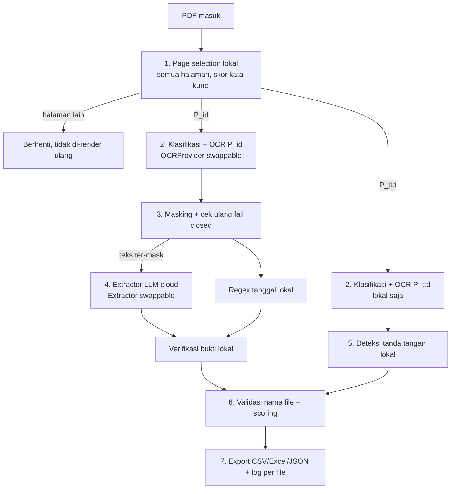

# PRD & RFC: Ekstraksi Kontrak Karyawan dari PDF

Oct 23, 2026 · @Alpha5

## 1. Latar belakang dan tujuan

Sistem ini membaca PDF kontrak karyawan dari berbagai vendor dan mengeluarkan tiga field per file: nama karyawan, masa kontrak, dan status tanda tangan karyawan. Gaji dan informasi rahasia lain tidak pernah keluar dari mesin lokal; yang keluar hanya teks halaman identitas yang sudah di-mask dan, di alur website, potongan gambar kecil baris NIK saat pemeriksaan lokal ragu dan area tanda tangan (Bagian 4).

Kondisi yang harus ditangani:

- Format kontrak berbeda per vendor, tidak ada template tetap.
- File selalu PDF, tetapi isinya bisa native (Word → PDF), scan/foto, atau hybrid (foto ditempel ke Word lalu dikonversi).
- Nama karyawan dan masa kontrak juga tertulis di nama file dengan pola `Nama Karyawan - Masa Kontrak - ENTITAS`, dapat dipakai sebagai pembanding; ENTITAS hanya ada di nama file dan disalin apa adanya ke output.
- Kontrak memuat gaji dan tunjangan; yang boleh keluar dari mesin lokal hanya teks halaman identitas yang sudah di-mask dan, di alur website, potongan baris NIK dan area tanda tangan (Bagian 4). Tidak ada halaman yang keluar utuh; halaman lain diproses sepenuhnya lokal.

Tujuan proyek:

1. Ekstraksi nama karyawan dan masa kontrak dengan akurasi yang bisa diukur di test set berlabel.
2. Penentuan status tanda tangan karyawan dengan tiga keluaran: signed, unsigned, uncertain.
3. Data minimization yang bisa dibuktikan lewat log halaman per file.
4. Hasil yang bisa dipercaya untuk dipakai langsung (auto-pass) atau ditinjau manusia (review queue) berdasarkan confidence score.

## 2. Ruang lingkup

Proyek ini berhenti di tiga field, NIK karyawan, dan status review; verifikasi keaslian tanda tangan dan ekstraksi klausul lain di luar scope.

Dalam scope:

- Input PDF native, scan/foto, dan hybrid, dari vendor mana pun.
- Ekstraksi nama karyawan, tanggal mulai, tanggal selesai (atau durasi bila dokumen hanya menyebut durasi).
- NIK karyawan, dibaca lokal dari teks halaman identitas sebelum masking dan tidak pernah ada di teks yang dikirim ke LLM; di alur website, potongan gambar baris angkanya saja dikirim bila pembacaan lokal ragu. Di keluaran di-mask secara default (Bagian 10 dan 12).
- Status tanda tangan karyawan: signed, unsigned, uncertain.
- Pembandingan hasil ekstraksi dengan nama file (fuzzy match nama, normalisasi tanggal).
- Confidence score per field dan review queue untuk kasus ragu.
- Log per file: halaman mana yang diproses, komponen mana yang menerimanya.
- Komponen OCR yang bisa ditukar antara lokal dan cloud, dan extractor LLM yang bisa ditukar antar penyedia cloud, tanpa mengubah pipeline.

Di luar scope:

- Ekstraksi gaji, tunjangan, atau klausul kontrak lainnya.
- Verifikasi bahwa tanda tangan benar milik karyawan tersebut (forensik tanda tangan).
- Status tanda tangan pihak perusahaan, stempel, dan materai.
- Validasi kriptografis e-signature; cukup dideteksi ada atau tidak.
- Perbaikan, pengeditan, atau penamaan ulang file PDF.
- Antarmuka review khusus pada fase pertama; review memakai spreadsheet hasil export.

## 3. Requirement fungsional

Sepuluh requirement di bawah ini mendefinisikan perilaku sistem; FR-1 sampai FR-7 wajib ada di rilis pertama.

| ID | Requirement | Prioritas |
| --- | --- | --- |
| FR-1 | Menerima satu file atau satu folder PDF, memproses per file, dan tidak gagal total karena satu file rusak. | Must |
| FR-2 | Menentukan halaman identitas dan halaman tanda tangan secara lokal; halaman lain tidak di-render, di-OCR, atau dikirim ke mana pun. | Must |
| FR-3 | Mengekstrak nama karyawan, tanggal mulai, tanggal selesai dari halaman identitas; mengembalikan null bila tidak ditemukan, tidak menebak. | Must |
| FR-4 | Mendeteksi tanda tangan karyawan di halaman tanda tangan dengan keluaran signed, unsigned, atau uncertain. | Must |
| FR-5 | Membandingkan nama dan masa kontrak hasil ekstraksi dengan nama file; mencatat cocok, mirip, atau tidak cocok. | Must |
| FR-6 | Menghasilkan confidence score per field dan keputusan auto-pass atau review per file. | Must |
| FR-7 | Menulis log per file: jumlah halaman, halaman terpilih, komponen yang menerima tiap halaman, alasan keputusan. | Must |
| FR-8 | Mengekspor hasil ke CSV/Excel dan JSON dengan skema tetap. | Should |
| FR-9 | Mengenali e-signature pada PDF native (field tanda tangan atau gambar di area tanda tangan). | Should |
| FR-10 | Menandai mismatch antara nama file dan isi dokumen sebagai temuan tersendiri, bukan sekadar error ekstraksi. | Could |

## 4. Requirement non-fungsional

Privasi adalah constraint utama. Dalam konfigurasi default CLI, satu-satunya data yang meninggalkan mesin lokal adalah teks `P_id` yang sudah di-mask, dikirim ke LLM cloud. Alur website (keputusan owner 2026-11-03, dengan izin mentor untuk NIK, posisi, dan tanda tangan) menambah dua potongan gambar: baris angka NIK di `P_id` bila pemeriksaan lokal ragu, dan area tanda tangan karyawan di `P_ttd` (ROI yang sedikit diperlebar) untuk setiap scan dan foto, serta untuk PDF teks bila pemeriksaan lokal ragu. Tidak ada halaman yang dikirim utuh, dan setiap potongan tercatat di log per file. OCR cloud adalah opsi non-default yang mengirim gambar `P_id` mentah sebelum masking (termasuk NIK dan alamat) dan hanya aktif dengan persetujuan tertulis terpisah; halaman lain tidak pernah keluar dalam konfigurasi apa pun. Satu-satunya pengecualian adalah mode uji "Tanpa OCR" di website (Bagian 7.1), yang dipilih per proses dan mengirim halaman pertama dan terakhir utuh tanpa masking; mode ini belum disetujui dan hanya dipakai dengan kontrak sintetis.

| Kategori | Requirement | Target awal |
| --- | --- | --- |
| Privasi | Halaman selain identitas dan tanda tangan tidak di-render ke gambar dan tidak di-OCR di luar tahap page selection lokal. | 0 halaman bocor, dibuktikan dari log |
| Privasi | Angka berpola rupiah, nomor rekening, dan deret ≥ 10 digit (termasuk yang dipisah spasi, strip, atau titik) di-mask sebelum teks dikirim ke LLM; bila pemeriksaan ulang masih menemukan deret angka, pengiriman dibatalkan (fail closed). | 100% ter-mask di test set dan korpus kebocoran |
| Privasi | Halaman tanda tangan diproses lokal lebih dulu. Hanya di alur website, potongan area tanda tangan saja dikirim ke Claude: untuk setiap scan dan foto, dan untuk PDF teks yang uncertain atau terbaca unsigned; selebihnya masuk review manusia. | 0 halaman tanda tangan utuh keluar; setiap potongan tercatat (`<extractor>:potongan_ttd`) |
| Privasi | Gambar hasil render dan teks OCR dihapus setelah file selesai diproses; hanya hasil akhir dan log yang disimpan. | Retensi 0 hari untuk data antara |
| Privasi | Untuk LLM cloud, dan OCR cloud bila dipakai: tier enterprise, no-training, zero atau limited retention, DPA ditandatangani, region Jakarta bila tersedia. OCR cloud nonaktif secara default lewat flag konfigurasi, karena mengirim gambar P\_id mentah sebelum masking, dan setiap aktivasinya dicatat di log per file. | Disetujui tertulis oleh client |
| Akurasi | Nama karyawan, setelah normalisasi, sama persis dengan label. | ≥ 95% di test set |
| Akurasi | Tanggal mulai dan selesai sama persis dengan label. | ≥ 95% di test set |
| Akurasi | Kontrak yang belum ditandatangani tidak dilabeli signed. | Recall unsigned ≥ 98% |
| Akurasi | Kontrak yang dilabeli signed memang ditandatangani. | Precision signed ≥ 98% |
| Operasional | Proporsi file yang lolos tanpa review manusia. | ≥ 80% |
| Performa | Waktu proses per file di mesin tanpa GPU, termasuk OCR lokal dua halaman. | ≤ 30 detik |
| Portabilitas | OCR diganti antara implementasi lokal dan cloud, dan LLM diganti antar penyedia cloud, lewat konfigurasi tanpa mengubah kode pipeline. | Satu flag konfigurasi |
| Auditabilitas | Setiap keputusan per file bisa ditelusuri ke halaman, komponen, dan skor yang menghasilkannya. | Log JSON per file |

Angka target di atas adalah usulan awal untuk disepakati dengan client setelah test set tersedia; yang tidak boleh turun adalah baris privasi.

## 5. Success metrics dan acceptance criteria

Proyek dinyatakan diterima bila semua kriteria di bawah terpenuhi pada test set berlabel yang disepakati bersama client, bukan pada sample pilihan tim.

| Metrik | Cara ukur | Kriteria terima |
| --- | --- | --- |
| Page selection recall | Halaman identitas dan halaman tanda tangan yang dipilih sama dengan label manusia | ≥ 95% file |
| Akurasi nama | Exact match setelah normalisasi (huruf kecil, tanpa gelar dan tanda baca) | ≥ 95% |
| Akurasi periode | Tanggal mulai dan selesai keduanya exact match | ≥ 95% |
| Recall unsigned | Dari semua kontrak berlabel unsigned, berapa yang tidak dilabeli signed oleh sistem | ≥ 98% |
| Precision signed | Dari semua yang dilabeli signed oleh sistem, berapa yang benar | ≥ 98% |
| Auto-pass rate | File dengan keputusan auto tanpa review | ≥ 80% |
| Kesalahan pada auto-pass | Field salah pada file yang lolos auto | ≤ 1% |
| Kebocoran halaman | Halaman di luar identitas dan tanda tangan yang tercatat dikirim ke komponen non-lokal | 0 |
| Waktu per file | Median di mesin tanpa GPU | ≤ 30 detik |

Metrik yang diprioritaskan bila harus memilih: recall unsigned dan kesalahan pada auto-pass. Kontrak yang belum ditandatangani tetapi dilaporkan signed adalah kegagalan paling mahal bagi HR, lebih mahal daripada file yang masuk review.

## 6. Asumsi, risiko, dan pertanyaan terbuka

Enam pertanyaan terbuka di bawah harus terjawab sebelum minggu kedua implementasi; dua di antaranya (kebijakan cloud dan lampiran setelah tanda tangan) mengubah desain.

Asumsi kerja:

- Identitas karyawan berada di halaman 1; masa kontrak berada di pasal awal, biasanya masih di halaman 1 tetapi bisa berlanjut ke halaman 2 pada vendor dengan pembukaan panjang.
- Blok tanda tangan karyawan berada di satu halaman di bagian akhir dokumen dan memuat nama karyawan tercetak, tetapi posisi vertikalnya tidak tetap: pada sampel berada di 44–54% tinggi halaman (Sampel A dan B) dan 65–69% (Sampel D).
- Dokumen berbahasa Indonesia, sebagian bercampur Inggris.
- Nama file dibuat manusia dan bisa salah; ia pembanding, bukan kebenaran.
- Tanda tangan karyawan berupa tanda tangan basah pada scan, atau e-signature pada PDF native; pada sampel native wujudnya anotasi Stamp (iOS Markup), anotasi Ink, atau gambar kecil, bukan field tanda tangan digital.

| Risiko | Dampak | Mitigasi |
| --- | --- | --- |
| Vendor baru dengan layout tak terduga | Page selection salah halaman, ekstraksi kosong | Skor jangkar berbasis kata kunci, bukan posisi; ambang rendah → review, bukan tebakan |
| Kualitas foto buruk (miring, gelap, blur) | OCR lokal gagal, nama tidak terbaca | Preprocessing deskew dan threshold; fallback OCR kedua; terakhir review |
| Client melarang cloud | Ekstraksi LLM tidak bisa dijalankan | LLM lokal tidak dipakai atas keputusan client, jadi ajukan paket syarat enterprise (no-training, retensi nol, DPA, region Jakarta) sejak Fase 0; bila tetap ditolak, scope ekstraksi menjadi pra-isi untuk diverifikasi manusia |
| OCR cloud aktif tanpa disadari | Gambar P\_id mentah (NIK, alamat) keluar sebelum masking | Flag nonaktif secara default, butuh persetujuan tertulis terpisah, setiap aktivasi tercatat di log per file |
| Stempel atau tulisan tangan di area tanda tangan | False positive signed | Filter komponen berdasarkan bentuk dan ukuran; zona abu-abu → uncertain |
| Tanda tangan native berupa anotasi atau vektor (Fill & Sign) | False unsigned lolos auto-pass | Cek anotasi, gambar, vektor, dan rasterisasi ROI; unsigned native memakai confidence normal, bukan tinggi |
| Gaji ada di halaman identitas | Data sensitif ikut ke LLM | Masking rupiah dan deret angka dengan pemisah diabaikan, pemeriksaan ulang fail closed, diuji dengan korpus kebocoran |
| Gemini free tier dipakai pada data asli | Melanggar NFR privasi (no-training) | Gemini hanya lewat Vertex AI; free tier dibatasi ke data sintetis saat development |
| Dependency berlisensi terlarang (AGPL, GPL, LGPL) | Melanggar kebijakan lisensi perusahaan, rilis tertahan | PyMuPDF (AGPL-3.0) diganti pypdfium2 dan pdfplumber; versi di-pin dan lisensi dipindai setiap perubahan dependency |
| Nama file tidak mengikuti pola `Nama Karyawan - Masa Kontrak - ENTITAS` | Sinyal pembanding hilang; bila banyak, auto-pass rate turun | Ditandai `filename_nonstandard` dan dinilai kuning; HR memeriksa kepatuhan pola lewat quick win di Bagian 14 sebelum batch dijalankan |
| Paraf dan coretan Ink di halaman isi | Anotasi salah dibaca sebagai tanda tangan karyawan | Anotasi hanya dihitung bila berpotongan dengan ROI karyawan |
| Nama file dan isi tidak cocok karena file salah simpan | Dianggap error ekstraksi | Mismatch dilaporkan sebagai temuan tersendiri (FR-10) |
| Test set terlalu kecil atau tidak mewakili semua vendor | Target akurasi tidak bisa dipercaya | Minimal 50 file, semua vendor dan ketiga jenis PDF terwakili |

Pertanyaan terbuka:

- [ ] Berapa volume file, dan apakah sekali jalan atau berkelanjutan?
- [ ] Apakah ada kontrak dengan lampiran setelah halaman tanda tangan?
- [ ] Apakah client mengizinkan OCR atau LLM cloud dengan syarat enterprise, dan untuk komponen mana?
- [ ] Bagaimana persis bagian masa kontrak ditulis di nama file? Sebagian terjawab: file produksi memakai pola `Nama Karyawan - Masa Kontrak - ENTITAS` (ENTITAS ditambahkan owner 2026-11-03); format tanggal di bagian masa kontrak (rentang tanggal panjang, singkatan bulan, atau durasi) masih perlu dikonfirmasi. Nama file sampel belum mengikuti pola ini dan tidak dipakai sebagai acuan format.
- [ ] Apakah ada kontrak berbahasa Inggris penuh?
- [ ] Berapa lama hasil ekstraksi dan log boleh disimpan, dan di mana?

Temuan dari empat file sampel (23 Okt 2026), dianalisis lokal dari struktur PDF tanpa membaca isi teks:

| File | Jenis | Tanda tangan karyawan (hlm 5) | Tanda tangan perusahaan | Objek lain |
| --- | --- | --- | --- | --- |
| Sampel A (nama file `Nama 1jan-31mar24`) | Native (PDF24, ditandatangani di iOS), 5 halaman | Anotasi Stamp, kolom kanan, 44–54% tinggi halaman | Vektor 79 kurva, kolom kiri | Ink di hlm 3 |
| Sampel B (nama file `Nama 1jan-31mar24`) | Native (PDF24), template sama dengan Sampel A, 5 halaman | Gambar kecil, kolom kanan, 46–54% | Vektor 79 kurva, kolom kiri | Ink di hlm 3 |
| Sampel C (nama file `Nama` saja) | Scan, satu gambar 99% per halaman, 5 halaman | Perlu OCR | Perlu OCR | Ink di hlm 2 |
| Sampel D (nama file `Nama` saja) | Native (iLovePDF), 5 halaman | Anotasi Ink, kolom kanan, 65–69% | Dua gambar bertumpuk (tanda tangan dan stempel), kolom kiri | Paraf Ink di pojok kiri bawah setiap halaman, Ink di hlm 2 |

Konsekuensi desain yang sudah dimasukkan ke bagian terkait:

- Cakupan bbox teks halaman native hanya 8–37%, sehingga klasifikasi native tidak memakai ambang cakupan teks (Bagian 9).
- Blok tanda tangan tidak selalu di bagian bawah halaman; jangkar memakai zona penutup, bukan persentase tinggi halaman (Bagian 8 dan 11).
- `Pihak Pertama` dan `Pihak Kedua` muncul berulang di isi pasal, sehingga kata kunci tanda tangan hanya dihitung di zona penutup (Bagian 8).
- Anotasi Ink juga muncul sebagai paraf dan coretan di halaman isi, termasuk pada file scan; hanya anotasi di ROI karyawan yang dihitung (Bagian 11).
- Tanda tangan perusahaan bisa berupa vektor; pemeriksaan vektor dibatasi ke ROI karyawan (Bagian 11).
- Nama file sampel belum mengikuti pola produksi `Nama Karyawan - Masa Kontrak - ENTITAS` (dua tanpa periode, dua dengan format rapat `1jan-31mar24`), sehingga parser nama file diuji dengan nama sintetis, bukan nama file sampel (Bagian 12).
- Belum ada sampel hybrid; test set Fase 0 wajib menambahkannya.

Uji lokal pipeline pada keempat sampel (26 Okt 2026, atas konfirmasi owner bahwa sampel diberikan tim untuk pengujian; extractor mati, keluaran di folder yang di-gitignore, hanya ringkasan tanpa PII yang dibaca). Pertama kali dijalankan, `P_ttd` tidak terpilih di keempat file, karena kalimat penutup vendor tidak dikenali dan footer berjalan mengosongkan zona penutup. Setelah aturan zona penutup dan blok tanda tangan di Bagian 8 dan 11 diperbaiki: `P_id` halaman 1 dan `P_ttd` halaman 5 di keempat file; tanda tangan karyawan terdeteksi signed di kolom kanan untuk semua file (A anotasi, B gambar, C tinta piksel dari scan, D anotasi), sesuai temuan struktur di atas; regex periode menemukan tanggal mulai di keempat file dan tanggal selesai di tiga (tidak di scan C); sekitar 1 detik per file native dan 15 detik untuk scan. Karena nama file sampel nonstandar dan extractor mati, jangkar yang dipakai adalah sebutan karyawan, sehingga margin tidak pernah jelas dan semua file masuk review. Uji kedua dengan extractor `claude-code` (owner menjalankannya sendiri dengan login Team-nya): nama terisi dan terverifikasi di keempat file, periode terisi dan sama dengan regex di tiga file native, dan dibuang verifikasi (`period_not_in_source`) di scan C karena tanggal jawaban tidak ada persis di teks OCR. Dengan jangkar nama, tanda tangan signed di keempat file setelah ROI dibentangkan sampai label karyawan (sebelumnya scan C uncertain). Tiga file native masuk `review` hanya karena `filename_nonstandard`; scan C `review_priority`. Ini uji asap, bukan pengukuran akurasi: sampel tidak berlabel dan tidak ada yang unsigned.

## 7. Arsitektur dan alur pipeline



Hanya panah `S3 → S4` yang melewati batas mesin lokal dalam konfigurasi default. OCR cloud, bila diaktifkan, berada di dalam `S2A` dan hanya untuk `P_id`.

Seluruh file dibaca hanya di tahap page selection lokal; setelah itu dua halaman yang hidup berpisah jalur. Dalam konfigurasi default, satu-satunya data yang keluar adalah teks `P_id` yang sudah di-mask (jalur kiri) ke LLM cloud; OCR cloud di jalur yang sama nonaktif kecuali disetujui terpisah. Halaman tanda tangan tidak pernah keluar utuh; di alur website hanya potongan area tanda tangan (scan dan foto, atau PDF teks yang ragu) dan potongan baris NIK yang ragu yang dikirim ke Claude.

### 7.1 Mode tanpa OCR (uji coba, keputusan owner 2026-11-04)

Website punya tombol pilihan per proses di halaman folder: **Dengan OCR** (alur di atas, default) dan **Tanpa OCR**. Owner dan mentornya belum mendapat keputusan apakah halaman utuh boleh dikirim ke LLM; mode ini cadangan untuk diuji dan akan diputuskan (dipertahankan atau dihapus) saat alur difinalkan. Dialog konfirmasinya memberi peringatan merah bahwa halaman dikirim utuh dan belum disetujui.

- Tesseract tidak dipakai. Page selection tidak dijalankan: halaman pertama dianggap halaman identitas dan halaman terakhir halaman tanda tangan. PDF hanya dibuka untuk jumlah dan jenis halaman, lalu kedua halaman di-render 200 dpi berwarna, diperkecil sampai sisi terpanjang paling banyak 2000 px, dan dikirim sebagai JPEG (kualitas 85) dalam satu panggilan Claude, masing-masing dengan label `Halaman pertama:` dan `Halaman terakhir:`. Kontrak satu halaman mengirim halaman itu sekali.
- Tanpa masking: nama, NIK, alamat, tempat dan tanggal lahir, dan apa pun yang tercetak di kedua halaman itu ikut terkirim.
- Claude mengisi semua field (nama, NIK, posisi, tanggal mulai dan selesai, durasi tertulis, perusahaan pemberi kerja, tanda tangan karyawan) dengan confidence, tanpa kutipan, ditambah tanggal lahir dan jenis kelamin yang tercetak untuk mengecek NIK. Model, effort, dan prompt caching sama dengan panggilan teks (Bagian 10).
- Yang tetap dicek di laptop: NIK harus valid strukturnya dan cocok dengan tanggal lahir dan jenis kelamin yang dibaca dari halaman yang sama (bertentangan → merah; hijau hanya bila keduanya cocok dan keyakinan Claude ≥ 0,8); nama dan periode dibandingkan dengan nama file (hijau hanya bila sama dan keyakinan ≥ ambang verifikasi); perusahaan pemberi kerja dibandingkan dengan folder vendor; tanda tangan diputuskan Claude dengan ambang yang sama dengan potongan (`signed` ≥ 0,8, `unsigned` ≥ 0,85, selain itu `uncertain`).
- Bila panggilan gagal, tidak ada pola teks cadangan: file itu gagal di website (`claude_failed`) dan bisa dicoba lagi. Mode ini menolak jalan bila Claude tidak siap (`claude_unavailable`).
- Log per file mencatat alasan `read_full_pages`, panggilan `halaman`, dan komponen `<extractor>:halaman_utuh` untuk kedua halaman.
- Uji awal (2026-11-04, kontrak sintetis): satu file 28 detik di CLI; dua file lewat website 15 detik dengan 4 worker, sekitar 15 ribu token per file, semua field benar dan siap dipakai.

## 8. Tahap 1: Page selection lokal

Semua halaman dibaca di mesin lokal hanya untuk memilih `P_id` (identitas dan periode, satu atau dua halaman) dan `P_ttd` (tanda tangan). Halaman lain berhenti di sini dan tidak pernah di-render ulang.

Langkah:

1. Buka PDF dengan pypdfium2. Untuk setiap halaman ambil teks dari text layer (`page.get_textpage().get_text_bounded()`).
2. Bila halaman bukan native (scan, hybrid, atau unclassified, lihat klasifikasi di Bagian 9) dan termasuk kandidat (tiga halaman pertama atau lima terakhir), render halaman ke grayscale 150 dpi, luruskan bila halaman miring minimal 0,5° (hapus bayangan dan deskew yang sama dengan baca penuh, tanpa binerisasi; foto ponsel yang miring beberapa derajat terbaca sebagai sampah tanpa langkah ini, sehingga halaman identitasnya tidak dikenali; halaman yang lurus tetap dibaca apa adanya karena hapus bayangan saja menghilangkan halaman sebanyak yang ditemukannya), lalu jalankan Tesseract lokal (`ind+eng`) hanya untuk mendapatkan teks kasar. Resolusi rendah cukup karena tujuannya skoring, bukan ekstraksi. Text layer halaman hybrid diabaikan karena biasanya hanya header/footer.
3. Hitung empat skor per halaman dari kata kunci dan pola di bawah: skor identitas, skor periode, skor tanda tangan, skor sensitif.
4. Tambahkan bonus bila nama dari nama file ditemukan secara fuzzy (rapidfuzz `partial_ratio` ≥ 85) di halaman itu: bonus besar untuk skor tanda tangan bila nama berada di zona penutup halaman (definisi di bawah tabel), bonus kecil untuk skor identitas.
5. `P_id` = halaman dengan skor identitas tertinggi di antara tiga halaman pertama. Bila halaman dengan skor periode tertinggi berbeda dan masih di tiga halaman pertama, halaman itu ikut menjadi `P_id` kedua; `P_id` maksimal dua halaman. `P_ttd` = halaman dengan skor tanda tangan tertinggi, dicari dari halaman terakhir ke depan, maksimal lima halaman. Halaman identitas utama tidak boleh menjadi `P_ttd` kecuali kontraknya satu halaman, karena pada halaman identitas yang pendek, label kedua pihak dan nama karyawan di bagian bawah bisa terlihat seperti blok tanda tangan.
6. Bila belum ada halaman yang bisa dipilih dan ada halaman gambar kandidat, halaman itu dibaca ulang pada 300 dpi (foto ponsel sering terlalu kecil teksnya untuk 150 dpi), lalu dipilih ulang. Halaman yang hampir tanpa kata yakin juga dibaca dalam putaran 90, 180, dan 270 derajat, dan putaran yang terbaca jauh lebih baik dipakai untuk OCR penuh dan tanda tangan (foto yang diambil miring ke samping atau terbalik). OSD Tesseract tidak dipakai karena gagal pada foto sintetis.
7. Bila skor identitas tertinggi tetap di bawah ambang, file masuk review dengan alasan `identity_page_not_found` (dan `signature_page_not_found` bila `P_ttd` juga tidak ada), tidak ada halaman yang dibaca, dan tidak melanjutkan ke tahap cloud mana pun. Bila hanya `P_ttd` yang di bawah ambang, `P_id` tetap dibaca seperti biasa: kandidat `P_ttd` dengan skor tertinggi (bila skornya di atas nol) diperiksa sebagai halaman tanda tangan dengan alasan `signature_page_guessed`, dan tanpa kandidat sama sekali alasannya `signature_page_not_found`. Page selection tetap merah, jadi file tetap masuk review prioritas, dan website menandai kolom tanda tangan untuk dicek. Alasannya: foto ponsel bisa kehilangan kolom karyawan di OCR, sehingga skor halaman tanda tangannya rendah (3 dari 93 foto sintetis), dan dulu seluruh nilainya ikut hilang.
8. Tulis manifest: nomor halaman terpilih, skor, halaman yang ditandai sensitif, putaran halaman, jumlah halaman total.

| Skor | Sinyal yang menambah skor |
| --- | --- |
| Identitas | `perjanjian kerja`, `perjanjian kerja waktu tertentu`, `PKWT`, `PKWTT`, `nama`, `NIK`, `No. KTP`, `tempat/tanggal lahir`, `jenis kelamin`, `selanjutnya disebut`, `Tenaga Kerja`, `Pihak Kedua`, `Para Pihak`, blok label-nilai `Nama : …` yang diikuti `NIK` atau tanggal lahir |
| Periode | `jangka waktu`, `berlaku efektif mulai tanggal`, `dimulai sejak tanggal`, `berakhir dengan sendirinya pada tanggal`, `sampai dengan tanggal`, `s/d`, dua pola tanggal dalam satu kalimat (`1 Januari 2024`, `01/01/2024`, `29-12-2023`) |
| Tanda tangan | `Pihak Pertama` dan `Pihak Kedua`, atau `IMECON`/nama perusahaan dan `Tenaga Kerja`, muncul berdekatan di zona penutup; `tanda tangan`, `menyetujui`, `materai`, `Jakarta, 1 Januari 2024` di zona penutup; nama karyawan di zona penutup; rasio teks rendah dengan area kosong besar setelah paragraf terakhir |
| Sensitif | `gaji`, `upah`, `tunjangan`, `THR`, `bonus`, `BPJS`, `potongan`, `Rp`, `rekening`, deret angka ≥ 10 digit |

Zona penutup adalah area dari paragraf penutup kontrak sampai batas atas pita footer; bila paragraf penutup tidak ditemukan, zona dimulai dari ujung bawah paragraf isi terakhir. Baris isi adalah baris dengan minimal enam kata dan lebar minimal 50% rentang teks halaman. Paragraf penutup ditandai salah satu frasa `demikian`, `dibuat dan ditandatangani`, `ditandatangani`, `menandatangani`, `tanda tangan`, `keadaan sadar`, `tanpa paksaan`, atau `rangkap`, karena tiap vendor merumuskannya berbeda (dua vendor di sampel tidak memakai `Demikian perjanjian`), dan paragrafnya bisa lebih dari dua baris. Zona dibuka di baris isi pertama yang memuat frasa itu dan diikuti paling banyak enam baris isi, agar frasa `dibuat dan ditandatangani` di paragraf pembuka halaman 1 atau kata `ditandatangani` di tengah pasal tidak membuka zona. Baris yang dimulai di bawah 92% tinggi halaman adalah footer berjalan (pada sampel, alamat perusahaan di 93–94% setiap halaman) dan tidak dihitung sebagai baris isi maupun bagian zona; tanpa aturan ini footer membuat zona penutup kosong. Posisi absolut tidak dipakai karena pada sampel blok tanda tangan berada di 44–54% tinggi halaman pada satu vendor dan 61–72% pada vendor lain. Kata kunci tanda tangan hanya dihitung di zona penutup, karena `Pihak Pertama` dan `Pihak Kedua` juga muncul berulang di isi pasal.

Skor sensitif tidak menggugurkan halaman identitas; ia mengaktifkan masking di Tahap 3 dan dicatat di log. Ambang skor dikalibrasi di test set, bukan ditetapkan di awal.

Mode hemat yang bisa dipakai bila volume besar: jalankan OCR skoring hanya pada tiga halaman pertama dan lima halaman terakhir. Halaman tengah tidak dibaca sama sekali, karena tidak pernah menjadi kandidat `P_id` atau `P_ttd`.

## 9. Tahap 2: Klasifikasi halaman dan OCR

Hanya `P_id` dan `P_ttd` yang masuk tahap ini. Tiap halaman diklasifikasikan native, scan, hybrid, unclassified, atau kosong, lalu dibaca lewat tangga OCR yang berhenti di anak tangga pertama yang cukup baik.

Format standar mengikuti sampel: PDF langsung dari Word (native) atau scan satu gambar penuh per halaman. Halaman berformat lain tetap dibaca lewat OCR, bukan dilewati, tetapi diberi kode temuan format. File dengan minimal satu temuan mendapat flag `format_nonstandard`, kolom `catatan_vendor`, dan komponen keputusan "format halaman" kuning, sehingga selalu masuk review.

Klasifikasi per halaman, dari statistik pdfplumber (jumlah karakter text layer, karakter di luar pita header/footer, luas gambar, dan segmen vektor):

| Jenis | Ciri | Cara baca | Temuan format |
| --- | --- | --- | --- |
| Native | Tidak ada gambar > 70% halaman, gabungan gambar < 40% halaman atau ada teks isi ≥ 200 karakter, dan text layer ≥ 50 karakter. Juga text layer 1–49 karakter tanpa gambar besar dan tanpa teks vektor, misalnya halaman tanda tangan yang hanya berisi label dan nama. Cakupan bbox teks tidak dipakai karena halaman native di sampel hanya 8–37% | Text layer langsung, dengan koordinat kata dari pdfplumber `extract_words()` | Tidak ada |
| Scan | Satu gambar menutupi > 70% halaman, dan text layer < 50 karakter atau berisi teks isi ≥ 200 karakter (scan searchable dari scanner) | Render 300 dpi → OCR; text layer diabaikan | Tidak ada |
| Hybrid | Satu gambar > 70% halaman dengan text layer ≥ 50 karakter yang hampir seluruhnya di pita header/footer (foto satu halaman ditempel ke Word bermargin sempit) | Perlakukan sebagai scan; text layer diabaikan | `scan_with_word_text` |
| Unclassified | Gabungan gambar ≥ 40% halaman tanpa teks isi: satu gambar ≥ 40% (`photo_in_document`, foto ditempel di dalam margin Word) atau beberapa potongan gambar (`split_images`). Juga text layer < 50 karakter dengan ≥ 1.000 segmen vektor (`vector_text`, teks di-outline), dan halaman tanpa teks yang hanya berisi gambar kecil (`image_without_text`) | Perlakukan sebagai scan | Kode di kolom kiri |
| Kosong | Tanpa teks, tanpa gambar, segmen vektor < 1.000 (halaman kosong dari page break, garis bingkai) | Tidak dibaca | Tidak ada |

Teks isi adalah karakter di luar pita header/footer, yaitu 10% teratas dan terbawah halaman. Ambang 70% saja tidak cukup untuk definisi hybrid di Bagian 1: foto halaman A4 yang ditempel di dalam margin default Word (1 inci) hanya menutupi 57–63% halaman. Dengan footer ≥ 50 karakter, halaman seperti itu dulu tergolong native, sehingga hanya footer yang terbaca dan isi foto diabaikan tanpa flag. Ambang 40%, 200 karakter, dan 1.000 segmen adalah nilai awal. Di sampel, gambar pada halaman native paling besar 1,5% halaman dan tanda tangan vektor perusahaan 79 segmen. Ketiganya dikalibrasi di test set Fase 0 yang wajib memuat file hybrid. Batasan: PDF native yang kop suratnya berupa gambar latar satu halaman penuh dibaca sebagai scan tanpa temuan, karena tanpa render mode teks pipeline tidak bisa membedakannya dari scan searchable. Pada mode hemat hanya halaman kandidat yang diklasifikasikan dan diperiksa formatnya.

Catatan vendor berisi satu kalimat per kelompok halaman dengan temuan yang sama, diikuti permintaan kirim ulang, misalnya `Halaman 1, 2: foto atau scan ditempel ke dokumen Word, tidak satu halaman penuh. Mohon kirim ulang sebagai PDF langsung dari Word, atau scan satu gambar penuh per halaman.` Isinya hanya nomor halaman dan jenis temuan, tidak pernah isi kontrak atau nama, sehingga HR bisa meneruskannya ke vendor. Kode temuan per halaman dicatat di `log.format_halaman`.

Tangga OCR untuk halaman scan, hybrid, dan unclassified:

1. Preprocessing dengan OpenCV: grayscale, deskew berdasarkan sudut garis teks dominan, adaptive threshold, penghapusan bayangan dengan background subtraction untuk foto HP.
2. Tesseract 5 lokal, bahasa `ind+eng`, mode `--psm 6`, keluaran `image_to_data` agar tiap kata punya bounding box dan confidence.
3. Uji kualitas: mean confidence kata ≥ 70, dan nama dari nama file ditemukan fuzzy di `P_id`. Lolos → selesai.
4. Gagal → PaddleOCR lokal, yang lebih tahan terhadap foto miring dan kontras rendah. Uji kualitas yang sama. Langkah ini ditunda sampai kualitas Tesseract diukur di test set; sebelum itu tangga langsung ke langkah 5.
5. Masih gagal → secara default file masuk review dengan alasan `ocr_low_confidence`. Dalam konfigurasi default tidak ada komponen cloud di tangga ini.
6. Opsi non-default `ocr.cloud_fallback: true`: OCR cloud (Azure Document Intelligence, Google Document AI, atau AWS Textract) untuk `P_id` saja. Opsi ini mengirim gambar halaman mentah sebelum masking, termasuk NIK dan alamat, sehingga hanya boleh diaktifkan dengan persetujuan tertulis terpisah dari client, dan setiap pemakaiannya dicatat di log per file. `P_ttd` tidak pernah masuk opsi ini.

Semua implementasi OCR memenuhi satu interface yang sama sehingga pipeline tidak tahu mana yang dipakai:

```python
class OCRProvider(Protocol):
    def read(self, image: np.ndarray) -> list[Word]: ...

@dataclass
class Word:
    text: str
    bbox: tuple[int, int, int, int]  # x0, y0, x1, y1 dalam piksel
    conf: float                      # 0..1
```

Teks native dari pdfplumber dibungkus ke struktur `Word` yang sama, sehingga Tahap 3 dan Tahap 4 bekerja pada daftar kata berkoordinat tanpa peduli sumbernya. Koordinat ini yang dipakai Tahap 4 untuk menemukan area tanda tangan.

## 10. Tahap 3: Masking dan ekstraksi nama & periode

Teks `P_id` di-mask dulu, lalu dikirim ke extractor yang mengembalikan JSON dengan skema tetap dan bukti kutipan. Nama yang tidak ditemukan di teks sumber ditolak, bukan diterima.

Pola teks: nilai yang sudah diketahui dicocokkan, bukan dibaca. Nama dari nama file harus tercetak di halaman identitas, periode nama file harus sama dengan periode yang dibaca regex atau, bila regex tidak membaca periode yang jelas, kedua tanggalnya tercetak di halaman identitas dalam format apa pun; regex tetap memveto (beberapa periode, atau periode lain). Nama folder vendor dicari di teks halaman identitas dan tanda tangan. Pada 300 kontrak sintetis pencarian tanggal mengonfirmasi 5 periode lebih banyak daripada regex saja dan tidak mengonfirmasi satu pun periode yang salah (periode kontrak lain, atau periode yang bergeser sebulan).

Website memakai satu alur, pola teks dibantu Claude (keputusan owner 2026-11-03, menggantikan pilihan dua metode; `extractor.assist`, `serve-stdio --claude`):

- Nama dan periode: pola teks lebih dulu; hijau atau merah tetap. Hanya file yang tetap kuning memakai nama dan periode yang dibaca Claude dari teks yang sama, setelah diverifikasi (`log.llm_cadangan`).
- Posisi: teks ter-mask setiap file yang lolos uji kualitas OCR dikirim, dan jabatan Claude yang terverifikasi menang; pembacaan lokal tetap jadi pembanding.
- Vendor: nama folder vendor dicari di teks lebih dulu; perusahaan pemberi kerja yang dibaca Claude hanya memutuskan file yang tidak ditemukan (`log.vendor_dari`).
- NIK: dibaca lokal lebih dulu. Bila tidak ada, tidak valid, bertentangan dengan tanggal lahir atau jenis kelamin tercetak, atau dibaca OCR tanpa kedua cek cocok, potongan gambar baris angka NIK saja dikirim ke Claude. NIK Claude harus lolos cek struktur, tanggal lahir, dan jenis kelamin yang sama; sama dengan lokal berarti terkonfirmasi, menggantikan lokal hanya bila lolos (hijau bila kedua cek cocok), dan angka lain yang tidak bisa menggantikan membuat NIK kuning (`log.nik.llm`). Dua NIK berbeda di dokumen tidak dikirim.
- Tanda tangan: dideteksi lokal lebih dulu (Bagian 11); potongan area tanda tangan dikirim untuk setiap scan dan foto, dan untuk PDF teks bila status lokal uncertain atau terbaca unsigned.
- ENTITAS selalu disalin dari nama file.

Potongan gambar dikirim dengan effort rendah dan sisi terpanjang paling banyak 1568 px. Token setiap panggilan (teks, potongan NIK, potongan tanda tangan) dijumlahkan per file (`log.token_llm`, `log.panggilan_llm`). Claude yang gagal meninggalkan pembacaan lokal. CLI dengan `extractor.enabled: true` tanpa `assist` membaca semua field dari teks dan tidak mengirim potongan.

Masking sebelum teks keluar dari mesin lokal:

| Pola | Contoh | Hasil |
| --- | --- | --- |
| Nominal rupiah | `Rp 7.500.000,-`, `Rp7.500.000`, `IDR 7,500,000` | `Rp [REDACTED]` |
| Angka dengan satuan uang | `7,5 juta`, `tujuh juta lima ratus ribu rupiah` | `[REDACTED]` |
| Deret ≥ 10 digit, pemisah diabaikan | `3171012345670001`, `3171 0123 4567 0001`, `0812-3456-7890`, `+62 812 3456 7890`; regex `(?<!\d)(?:\d[\s.\-]?){9,}\d(?!\d)`, dijalankan setelah tanggal numerik dilindungi | `[REDACTED-ID]` |
| Baris dengan kata kunci sensitif | baris yang memuat `gaji`, `upah`, `tunjangan`, `THR`, `bonus` | seluruh baris diganti `[REDACTED-LINE]` |
| Baris identitas yang tidak dibutuhkan | baris berlabel `Alamat`, `Telepon`, `Tempat/Tgl Lahir`, `Tempat dan tanggal lahir` | seluruh baris diganti `[REDACTED-LINE]`; label `Nama`, `Jabatan`, `NIK` dipertahankan agar LLM bisa membedakan blok karyawan dari blok perwakilan perusahaan |
| Nilai baris nomor identitas | baris berlabel `NIK`, `No. KTP`, `No. Induk Kependudukan`, `NPWP`, `No. Rekening`, termasuk nilai yang digitnya pecah karena OCR (`3171O1234567OOO1`) dan lolos dari pola deret digit | label dipertahankan, seluruh nilai diganti `[REDACTED-ID]` |
| Nomor identitas di tengah kalimat | `pemegang NIK 3171O1234567OOO1, beralamat …`: nilai sampai koma, titik koma, atau akhir baris (paling banyak 30 karakter) setelah label NIK, KTP, atau Induk Kependudukan, bila memuat minimal 4 digit | label dipertahankan, nilai diganti `[REDACTED-ID]`; label tanpa nomor (`sesuai NIK yang tercantum`) tidak tersentuh |

Tanggal kalender valid dengan tahun empat digit (`\d{1,2}[/.\-]\d{1,2}[/.\-]\d{4}`) dikenali lebih dulu dan dikecualikan dari pencocokan deret digit, karena dua tanggal yang hanya dipisah satu spasi (`01.01.2024 31.03.2024`) akan menyatu menjadi 16 digit dan ikut ter-mask; satu tanggal paling panjang delapan digit. Nama tidak tersentuh. Setelah masking, teks diperiksa ulang dengan aturan yang sama (deret digit dengan pengecualian tanggal, ditambah pola rupiah). Pemisah tidak dihapus secara global, karena itu akan menggabungkan tanggal berdampingan seperti `01-01-2024 - 31-03-2024` menjadi deret 16 digit dan memicu `mask_leak` palsu. Bila masih ada, pengiriman ke LLM dibatalkan dan file masuk review dengan alasan `mask_leak` (fail closed). Masking diuji dengan korpus kebocoran, yaitu baris sintetis berisi NIK, rekening, nomor HP, dan gaji dalam berbagai format pemisah, yang dijalankan di pytest pada setiap perubahan; hasil per file dicatat di log sebagai jumlah pola yang diganti.

Skema keluaran extractor:

```json
{
  "nama_karyawan": {"kutipan": "string", "nilai": "string | null", "confidence": "0.0 - 1.0"},
  "posisi": {"kutipan": "string", "nilai": "string | null", "confidence": "0.0 - 1.0"},
  "tanggal_mulai": {"kutipan": "string", "nilai": "YYYY-MM-DD | null", "confidence": "0.0 - 1.0"},
  "tanggal_selesai": {"kutipan": "string", "nilai": "YYYY-MM-DD | null", "confidence": "0.0 - 1.0"},
  "durasi_bulan": {"kutipan": "string", "nilai": "int | null", "confidence": "0.0 - 1.0"},
  "vendor": {"kutipan": "string", "nilai": "string | null", "confidence": "0.0 - 1.0"}
}
```

Skema ditegakkan lewat structured output (`OUTPUT_SCHEMA` di `extractor_method/llm/prompt.py`: semua field wajib, `additionalProperties: false`), sehingga Claude API dan Claude Code mengembalikan bentuk yang sama. Kutipan adalah potongan teks sumber yang bersambung, disalin apa adanya termasuk salah OCR-nya, paling banyak 25 kata; confidence 0 bila nilainya null.

Aturan prompt untuk LLM:

- Ambil nama pihak karyawan, bukan perwakilan perusahaan, direktur, atau saksi. Sebutannya berbeda per vendor: `Tenaga Kerja`, `PIHAK KEDUA`, `Pekerja`, `Karyawan`; karyawan adalah pihak yang bertindak untuk dan atas nama sendiri, bukan untuk dan atas nama PT.
- Blok `Nama :` pertama di halaman bisa milik perwakilan perusahaan (biasanya disertai `Jabatan` dan alamat kantor). Blok karyawan ditandai `NIK` atau `No. KTP` dan tanggal lahir.
- Nama ditulis persis seperti tercetak, termasuk ejaan, huruf besar-kecil, dan gelar akademik di belakang nama (`, S.E.`, `, A.Md.`); hanya sapaan di depan (`Bapak`, `Ibu`, `Sdr.`) dan label yang dibuang. Ejaan tidak diperbaiki; nama yang tidak terbaca utuh dikembalikan null.
- Posisi diambil dari baris `Jabatan`/`Posisi` di blok karyawan atau dari kalimat penempatan (`sebagai …`), hanya jabatannya tanpa nama perusahaan atau lokasi. Jabatan perwakilan perusahaan tidak pernah diambil; dua jabatan berbeda untuk karyawan berarti null.
- Tanggal penandatanganan di paragraf pembuka (sering ditulis dalam kata, misalnya `Dua Puluh Sembilan bulan Desember tahun Dua Ribu Dua Puluh Tiga`), tanggal lahir, tanggal nomor surat, masa percobaan, dan tanggal kontrak lama yang hanya dirujuk bukan periode kontrak. Untuk perpanjangan atau addendum, periode yang diambil adalah periode yang ditetapkan dokumen itu. Periode diambil dari kalimat yang memuat `dimulai`, `berlaku efektif`, `berakhir`, atau `sampai dengan`.
- Bulan dalam bahasa Indonesia dan Inggris (`Juli` dan `July`) dinormalisasi ke angka; tanggal angka dibaca hari dulu (`05/03/2026` = 5 Maret 2026); tahun dua digit ditolak sebagai null.
- Bila dokumen hanya menyebut durasi (`12 bulan`), isi `durasi_bulan` dan biarkan `tanggal_selesai` null; pipeline menghitungnya dari tanggal mulai.
- Tidak boleh menebak. Field yang tidak ada di teks dikembalikan null.
- Confidence per field mengikuti rubrik tetap: 0,95–1,0 tertulis eksplisit, bersih, satu kandidat, pihaknya jelas; 0,80–0,94 satu karakter rusak oleh OCR atau pihaknya disimpulkan dari konteks; 0,50–0,79 memilih di antara kandidat atau membaca teks rusak; di bawah 0,50 lebih baik null. Prompt menutup dengan satu contoh fiktif dan daftar cek akhir.
- Teks yang dikirim dibatasi ke `P_id` saja, maksimal 4.000 karakter per halaman, karena identitas dan pasal periode hampir selalu di bagian awal. Tiap halaman di-mask dulu baru dipotong, karena memotong lebih dulu bisa menyisakan potongan NIK di bawah 10 digit yang lolos dari pola deret digit. Halaman digabung dengan dua baris baru agar digit di ujung halaman tidak menyatu dengan digit di awal halaman berikutnya. `teks_keluar_karakter` di log hanya diisi saat extractor benar-benar mengirim teks.

Verifikasi lokal setelah LLM menjawab, per field, terhadap payload ter-mask yang persis dilihat LLM: kutipan tiap field harus ditemukan di teks sumber (fuzzy ≥ 90, huruf dan digit), nama yang diekstrak harus cocok dengan satu baris teks sumber (nama depan saja tidak cukup), posisi harus ada di dalam kutipannya, tanggal yang diekstrak harus muncul dalam salah satu bentuk di teks sumber, dan durasi harus tertulis di teks atau sama dengan selisih tanggal; tanggal selesai yang tidak setelah tanggal mulai membuang keduanya. Field yang gagal verifikasi dibuang menjadi null dengan alasan `name_not_in_source`, `period_not_in_source`, atau `position_not_in_source`, sehingga komponen ekstraksi kuning (lihat Bagian 12). Bila hanya durasi yang ada, tanggal selesai dihitung dari tanggal mulai (1 Januari + 12 bulan = 31 Desember); bila tanggal ulang tahun kontrak tidak ada di bulan tujuan (31 Januari + 1 bulan), tanggal selesai dibiarkan null untuk review. Teks `P_id` dari OCR yang gagal uji kualitas tidak dikirim sama sekali, karena OCR yang buruk bisa memecah NIK menjadi deret pendek yang lolos dari masking.

Jalur paralel tanpa LLM yang selalu jalan, lokal, pada teks `P_id` sebelum masking: regex tanggal mengumpulkan tanggal bentuk teks (`1 Januari 2026`, `01 Jan. 2026`, `1 (satu) Januari 2026`, `tanggal 1 bulan Januari tahun 2026`, bulan Indonesia dan Inggris dengan singkatannya) dan bentuk angka (`\d{1,2}[/.-]\d{1,2}[/.-]\d{4}` dengan pemisah yang sama), tetapi hanya yang berada dalam 120 karakter setelah kata jangkar. Jangkar mulai: `mulai`, `dimulai`, `berlaku efektif`, `sejak`, `terhitung`. Jangkar selesai: `berakhir`, `sampai dengan`, `hingga`, `s/d`. Peran tanggal ditentukan jangkar terdekat sebelumnya, kecuali tanggal yang langsung diikuti `s/d`, `sampai dengan`, atau `hingga`, yang selalu dibaca sebagai tanggal mulai (bentuk rentang `1 Januari 2026 s/d 31 Desember 2026`). Tanggal dalam 40 karakter setelah `lahir`, dan tanggal di paragraf pembuka sebelum blok `Nama :` pertama, diabaikan karena itu tanggal lahir dan tanggal penandatanganan. Tahun dua digit tidak cocok dengan pola dan karena itu tidak pernah dibaca. Durasi (`12 (dua belas) bulan`, `1 tahun`) hanya dihitung dalam 60 karakter setelah `jangka waktu`, `selama`, `masa kontrak`, atau `masa berlaku`, dan diabaikan bila `percobaan` ada dalam 40 karakter di sekitarnya. Kandidat yang bertentangan (dua tanggal mulai berbeda, dua tanggal selesai berbeda, dua durasi berbeda) membuat field itu null dan menandai `ambigu`; tanggal selesai yang tidak setelah tanggal mulai, atau durasi yang tidak sama dengan selisih tanggal, membuat semua field terkait null. Hasilnya dicatat di log sebagai `periode_regex`. Kalau LLM dan regex sepakat, confidence naik; kalau tidak, file masuk review.

NIK karyawan dibaca di jalur lokal yang sama, pada teks `P_id` sebelum masking, dan tidak pernah ada di teks yang dikirim ke LLM (keputusan owner 2026-11-02); di alur website, bila pembacaan lokal ragu, hanya potongan gambar baris angkanya yang dikirim (Bagian 10). Pembaca hanya melihat nilai setelah label (`NIK`, juga `N1K` hasil OCR, `No. KTP`, `Nomor KTP`, `No. Induk Kependudukan`), di baris yang sama atau di awal baris berikutnya bila nilainya terbungkus, sehingga nomor KK, NPWP, rekening, dan nomor HP tidak terambil. Deret tepat 16 digit dipakai lebih dulu; bila tidak ada, huruf yang sering tertukar dengan angka di hasil scan (`O`→0, `I`/`l`→1, `S`→5, `B`→8, …) diganti dan setiap jendela 16 digit dari deret yang lebih panjang dicoba, karena titik dua bisa terbaca `1`. NIK yang dipilih dari deret lebih dari 16 digit dicatat `deret_panjang` dengan alasan `nik_digits_repaired`, selalu kuning, dan di website potongan baris NIK-nya dikirim ke Claude walau tanggal lahir dan jenis kelamin cocok, karena kedua pemeriksaan itu hanya mencakup digit 7–12 (di run website 2026-11-04 satu pilihan jendela salah di tiga digit pertama dan lolos keduanya). Baris OCR yang tidak berisi satu huruf atau angka pun (`|`, `�`, serpihan garis tabel atau tepi halaman) dibuang dari teks sebelum dibaca, sehingga nilai di bawah label tetap terhitung baris berikutnya. Bila halaman identitas hasil OCR yang lolos uji kualitas tidak memberi NIK atau posisi, halaman itu dibaca sekali lagi dengan garis tabel dihapus, dan hasilnya dipakai hanya bila lolos uji kualitas, menemukan yang tadinya hilang (NIK yang tidak dibantah tanggal lahir atau jenis kelamin), dan tidak kehilangan NIK, posisi, atau kedua tanggal periode yang sudah terbaca. Angka harus berstruktur NIK: kode provinsi yang ada, kode kabupaten/kota, kecamatan, dan nomor urut bukan nol, serta tanggal lahir valid (hari +40 untuk perempuan). NIK yang lolos dicocokkan dengan tanggal lahir tercetak (tanggal pertama setelah `lahir`) dan jenis kelamin tercetak (setelah `jenis kelamin`, atau sebelum label NIK di kalimat pembuka). Dua NIK valid yang berbeda membuat NIK null dengan status `bertentangan`, tidak memilih salah satu. Log per file hanya mencatat status (`ditemukan`, `bertentangan`, `tidak_valid`, `tidak_ditemukan`) dan hasil pencocokan (`cocok`, `tidak_cocok`, `tidak_ada`), tidak pernah angkanya.

Implementasi extractor ada dua, keduanya API cloud dan dipilih lewat konfigurasi: Claude API dengan structured output (akurasi tertinggi) dan Gemini Flash via Vertex AI (terms enterprise dan no-training; Google AI Studio free tier tidak memenuhi NFR privasi dan hanya boleh dipakai pada data sintetis saat development). LLM lokal tidak dipakai atas keputusan client, sehingga persetujuan kebijakan cloud untuk komponen ini menjadi prasyarat proyek. Keduanya diukur di test set yang sama, dan selisihnya dilaporkan ke client sebagai dasar pemilihan.

Detail implementasi: extractor mati secara default (`extractor.enabled: false`), sehingga menjalankan CLI tidak mengirim apa pun sampai kebijakan cloud disetujui dan konfigurasi diubah dengan sadar. Bila diaktifkan tetapi kredensial atau model tidak valid, CLI berhenti sebelum membaca file mana pun (cek lewat endpoint model, tanpa teks dokumen). Claude memakai model default `claude-haiku-5-5` dengan effort `max` (permintaan owner 2026-11-02; keduanya bisa diubah lewat `extractor.model` dan `extractor.effort`, di website `CLAUDE_MODEL` dan `CLAUDE_EFFORT`), adaptive thinking, structured output (`output_config.format` dengan skema JSON tetap), prompt sistem dengan `cache_control`, dan request yang di-stream karena `max_tokens` besar. Fallback sisi server untuk permintaan yang ditolak classifier keamanan (`extractor.refusal_fallback`) hanya dikirim untuk model yang mendukungnya; Haiku tidak. Provider `claude` memilih kredensial seperti sumber folder memilih SharePoint atau folder lokal: bila `ANTHROPIC_API_KEY` diisi, lewat Claude API (produksi, key dari Vault); bila kosong, lewat Claude Code dengan login pengguna yang menjalankan (uji lokal, lihat provider `claude-code` di bawah). Bila Claude gagal atau teks OCR tidak lolos uji kualitas sehingga tidak dikirim, file itu dinilai dengan mode pola teks di bawah (`log.pembaca: pola`), bukan langsung merah. LLM diberi teks `P_id` ter-mask, bukan gambar halaman: pada 200 kontrak sintetis (2026-11-02, Haiku 5.5 effort `max`), gambar `P_id` 150 dpi memberi 176 file hijau dan teks 168 dari 193 file yang sama, nol nilai salah di baris hijau pada keduanya, tetapi gambar halaman identitas membawa NIK, alamat, dan kadang gaji yang hanya bisa ditutup bila OCR menemukan setiap areanya, dan halaman terakhir adalah `P_ttd` yang tidak pernah keluar. Gemini hanya lewat Vertex AI (`vertexai=True`, Application Default Credentials, tanpa API key) dan id modelnya wajib diisi di konfigurasi. Prompt menyatakan bahwa teks kontrak adalah data, bukan instruksi. Kegagalan API dicatat sebagai `extractor_error:<jenis>` tanpa isi pesan, dan file lain tetap diproses. Log per file mencatat `extractor`, `teks_keluar_karakter` (dihitung saat permintaan dikirim, juga bila permintaan gagal), dan komponen `<extractor>:masked` di `komponen_halaman` untuk setiap halaman `P_id`.

Mode pola teks (extractor mati, keputusan owner 2026-11-02): nama dan periode tetap bisa lolos tanpa LLM bila dua sumber independen sepakat. Nama dari nama file standar harus tercetak di halaman identitas (pencarian fuzzy per baris; hasilnya dicatat di `log.validasi_nama_file.nama` dan tampil sebagai Cocok di samping nama di website, sedangkan sel NAMA KARYAWAN di Excel berwarna bila nama tidak ditemukan), dan periode regex harus sama persis dengan periode nama file. Keduanya lalu mengisi `nama_karyawan`, `tanggal_mulai`, `tanggal_selesai`, dan `durasi_bulan`, dan level ekstraksi hijau. Nama tidak tercetak (`name_not_in_source`), periode tidak lengkap (`period_not_in_source`), atau selisih beberapa hari memberi kuning tanpa mengisi field. Periode bertentangan (`period_conflict`) atau berbeda dari nama file (`filename_mismatch`) memberi merah. Skor halaman yang tipis (kuning) dianggap hijau bila kedua halaman terbukti dari isinya: nama dan periode terkonfirmasi di `P_id`, dan nama karyawan menjadi jangkar tanda tangan di `P_ttd`. Bila tidak, alasannya `page_selection_low_margin`; merah tidak pernah diangkat. Tanda tangan yang marginnya tidak jelas mendapat alasan `signature_not_clear`. CLI dan image tetap `decision.allow_auto: false`; website menyalakannya lewat `ALLOW_AUTO=true` (flag `serve-stdio --allow-auto`), sehingga file yang semua komponennya hijau menjadi Otomatis.

Provider ketiga, `claude-code`, untuk uji lokal tanpa API key: extractor menjalankan binary Claude Code yang tidak dimodifikasi (`claude -p`) yang sudah login lewat `claude auth login` milik pengguna yang menjalankan, dan tidak pernah membaca, menyimpan, atau meneruskan token login. Ketentuan Anthropic (Claude Code, Legal and compliance) membatasi login claude.ai untuk pemakaian Claude Code oleh pemiliknya dan mengarahkan produk atau layanan ke API key atau penyedia cloud, sehingga provider ini tidak dipakai di layanan produksi dan Claude Code tidak dimasukkan ke image. Akun Team dan Enterprise tunduk pada Commercial Terms; persetujuan kebijakan cloud client tetap berlaku untuk data asli. Isolasi sesinya: payload lewat stdin (tidak pernah di argumen proses), prompt sistem ekstraksi menggantikan prompt bawaan lewat file, tanpa tool (`--tools ""`), tanpa MCP, skill, dan setting pengguna, tanpa transkrip sesi (`--no-session-persistence`), di folder kosong yang dihapus setelah panggilan, structured output dengan skema yang sama (`--json-schema`), dan telemetri, laporan error, serta cek update Claude Code dimatikan untuk proses itu. Di Windows, shim npm `claude.cmd` dilewati dan `claude.exe` dipanggil langsung, karena cmd.exe memotong argumen multi-baris tanpa error. Login diperiksa dengan `claude auth status` sebelum file pertama dibaca; kegagalan per file dicatat sebagai `extractor_error:cli:<subtype>`, `timeout`, atau `no_output`.

## 11. Tahap 4: Deteksi tanda tangan karyawan

Deteksi berjalan sepenuhnya lokal di `P_ttd`, berjangkar pada posisi nama karyawan tercetak, dan mengeluarkan tiga status: signed, unsigned, uncertain. Status biner tanpa zona abu-abu ditolak karena recall unsigned adalah metrik yang paling dijaga.

Jalur PDF native (tanpa scan):

1. Cek field tanda tangan digital lewat pdfplumber `page.annots`: widget dengan `/FT /Sig` (boleh diwarisi dari field induk) yang sudah berisi nilai `/V` dan berpotongan dengan ROI. `/SigFlags` pada `/AcroForm` tidak dipakai, karena berlaku untuk seluruh dokumen dan ikut menyala bila hanya perusahaan yang menandatangani secara digital. Ada → `signed` dengan sumber `digital`.
2. Cek `/Annots` halaman lewat pdfplumber: tipe Ink, Stamp, FreeText, atau FileAttachment yang bounding box-nya berpotongan dengan ROI (langkah 3 jalur scan). Ini menangkap tanda tangan dari Acrobat Fill & Sign, iOS Markup (pada sampel berupa Stamp), dan aplikasi sejenis. Anotasi di luar ROI diabaikan dan hanya dicatat di log, karena sampel memuat paraf Ink di pojok setiap halaman dan coretan Ink di halaman isi. Ada di ROI → `signed` dengan sumber `annotation`.
3. Cek gambar lewat pdfplumber `page.images` yang berpotongan dengan ROI, bukan gambar latar satu halaman penuh, dan bukan meterai (gambar yang kotaknya hampir sama dengan kotak meterai, intersection over union ≥ 0,6, lihat langkah 4 jalur scan; gambar tanda tangan yang ditempel setengah di atas meterai hanya 0,30–0,46 di data sintetis dan tetap dihitung). Ada → `signed` dengan sumber `image`. Gambar meterai tidak dihitung sebagai objek, tetapi bila sisa tinta di ROI setelah warna meterai dibuang tetap mirip tanda tangan, statusnya `signed` dengan sumber `image`: karyawan menandatangani di atas meterai.
4. Cek vektor lewat pdfplumber `page.curves`: path yang berpotongan dengan ROI dengan total minimal 8 segmen dan total panjang goresan minimal satu kali lebar ROI, ciri tanda tangan yang sudah di-flatten menjadi konten halaman; centang atau garis bawah pendek tidak mencapainya. Ada → `signed` dengan sumber `vector`. Pada sampel, tanda tangan perusahaan berupa vektor di kolom kiri, sehingga pembatasan ke ROI karyawan wajib.
5. Apa pun hasil langkah 1 sampai 4, render halaman 300 dpi dan jalankan analisis tinta yang sama dengan jalur scan pada ROI. Objek dan tinta harus sepakat:

| Objek di ROI | Tinta signed | Tinta di zona tengah | Tinta kosong |
| --- | --- | --- | --- |
| Field digital | `signed`, margin jelas | `signed` | `signed` (field digital boleh tak kasat mata) |
| Anotasi, gambar, atau vektor | `signed`, margin jelas | `signed` | `uncertain` |
| Tidak ada | `uncertain` (tinta tanpa objek yang menjelaskannya) | `uncertain` | `unsigned` |

`unsigned` pada PDF native mendapat confidence normal, bukan tinggi, karena cara menandatangani PDF native terus bertambah.

Jalur scan, hybrid, dan unclassified:

1. Render `P_ttd` dengan anotasi ikut di-render (file scan di sampel juga memuat anotasi Ink), pada resolusi baca OCR (`ocr.read_dpi`, 300 dpi) dan dengan koreksi kemiringan yang sama dengan OCR, sehingga piksel sejajar dengan daftar `Word` berkoordinat dari Tahap 2. Field digital dan anotasi yang berpotongan dengan ROI dicek seperti langkah 1 dan 2 jalur native; gambar tidak dicek, karena halaman scan itu sendiri gambar. Tanpa objek, status diambil dari analisis tinta, dengan sumber `pixels` bila signed.
2. Temukan jangkar utama: deretan kata bersebelahan di satu baris zona penutup (Bagian 8) yang cocok fuzzy dengan nama karyawan, skor terbaik dari perbandingan tanpa spasi dan `token_sort_ratio`, minimal 85, atau 90 bila nama hanya satu kata seperti `Abd.karim`. Nama depan saja tidak mencapai ambang. Jarak antar kata lebih dari 2× tinggi kata memutus deretan, sehingga nama perwakilan perusahaan dan nama karyawan pada baris yang sama tidak pernah menyatu. Jangkar sekunder: sebutan karyawan yang ditemukan di teks `P_id` (`PIHAK KEDUA`, `Tenaga Kerja`, `Karyawan`, `Pekerja`; semuanya bila tidak satu pun ditemukan) di zona penutup. Bila sebutan itu muncul dua kali bertumpuk secara vertikal (label di atas, peran di bawah nama, seperti pada vendor 1), ROI adalah area di antara keduanya; bila hanya satu, ROI di bawahnya. Label pihak perusahaan (`PIHAK PERTAMA`, `Pengusaha`, `Perusahaan`, `Direktur`, `PT`) tidak pernah menjadi jangkar; label di kolom lain membatasi ROI di titik tengah antara label itu dan jangkar.
3. Tentukan ROI relatif terhadap bounding box nama: lebar 2,5× lebar nama dipusatkan pada nama, dibatasi maksimal setengah lebar halaman dan tidak melewati batas kolom pihak perusahaan; membentang ke atas dari batas bawah nama sehingga bbox nama ikut masuk, karena tanda tangan bisa menimpa nama tercetak. Bila ada baris blok di atas nama di kolom yang sama, paling jauh 14× tinggi nama (bukan 10×: kontrak foto yang ditandatangani di atas meterai punya jarak sekitar 12× tinggi nama antara `Tenaga Kerja,` dan nama), ROI membentang tepat sampai baris terdekat itu, karena ruang di antara baris itu dan nama adalah tempat tanda tangan; baris itu bisa label sebutan karyawan atau judul kolom lain seperti `Yang menerima,`. Hanya kata tercetak yang dihitung (confidence OCR ≥ 0,70, tinggi ≤ 1,6× median tinggi kata, minimal tiga huruf per kolom), karena OCR membaca tanda tangan di scan sebagai kata sampah, dan baris sampah itu memotong ROI tepat di bawah tanda tangannya (13 scan sintetis); label sebutan karyawan yang cocok tetap dihitung walau OCR-nya rusak. Keterangan tanda tangan elektronik (`Ditandatangani secara elektronik ...`, `Digitally signed`) tidak pernah membatasi ROI, karena letaknya tepat di bawah tanda tangan yang diterangkannya; dikenali dari semua katanya, termasuk yang confidence OCR-nya rendah karena hurufnya kecil. Bila keterangan itu ada di ROI, kata tercetak di seluruh ROI di atas nama dihitung sebagai tinta, karena tanda tangan berhuruf script di atas keterangannya bisa dibaca OCR sebagai kata. Pada uji website 800 file (2026-11-04), keterangan yang tinggi di atas nama memotong ROI di bawah tanda tangannya, dan dua foto bertanda tangan terbaca unsigned. Tanpa baris seperti itu, tingginya 5× tinggi baris nama. Pada scan C tanda tangan ditulis tinggi di ruang selebar sekitar tujuh tinggi nama, sehingga ROI tetap 5× hanya melihat tepi bawahnya (uncertain), dan pada tata letak sintetis serupa bahkan memberi unsigned palsu. ROI kedua ke bawah dari nama dibuat hanya bila ROI pertama `unsigned` tanpa objek.
4. Buang meterai lewat warna, sebelum binerisasi. Halaman juga di-render berwarna; meterai Rp10.000 berwarna merah muda-magenta (hue OpenCV 140–179, saturasi ≥ 50), sedangkan tinta pena biru berada di hue sekitar 100–125. Area berwarna meterai yang padat (minimal 25% kotaknya) dan berukuran meterai (sisi 2,5–20% tinggi halaman) dicatat sebagai kotak meterai. Di dalam kotak itu saja, piksel berwarna meterai dijadikan putih; piksel gelap (value ≤ 90) dan piksel jenuh dengan hue lain tetap, karena itu goresan pena di atas meterai. Tanda tangan ungu di luar kotak tidak tersentuh. Halaman tanpa warna (scan grayscale, persentil 99,9 saturasi < 25) tidak punya warna untuk dipegang: di sana meterai adalah area padat yang lebih gelap minimal 20 tingkat dari kertas (minimal 70% dari jendela selebar 1,5% tinggi halaman, dan 60% dari kotaknya), sedangkan pena dan teks berupa goresan tipis. Pena dan pola meterai tidak bisa dipisahkan di grayscale, jadi seluruh kotak dijadikan putih; pada 200 kontrak sintetis ini mengubah 3 kontrak unsigned yang terbaca signed (pola meterai grayscale dihitung tinta) menjadi uncertain, dan 4 kontrak yang ditandatangani di atas meterai grayscale juga menjadi uncertain. Scan hitam-putih 1-bit memecah warna meterai menjadi garis gelombang dengan kertas di antaranya, sehingga hanya bagian terpadatnya (tulisan `METERAI TEMPEL` dan nilainya) yang lolos sebagai inti; pada uji website 800 file (2026-11-04) satu inti hanya seperlima meterainya, dan sisa gelombangnya terbaca sebagai tanda tangan pada kontrak unsigned. Inti yang lebih kecil dari meterai (lebar < 6% dan tinggi < 4% tinggi halaman) diperluas ke pola yang tersambung dengannya, setelah garis lurus panjang (garis tanda tangan) dibuang, selama hasilnya tidak lebih besar dari meterai (11% × 7,5%); inti seukuran meterai tidak diperluas, agar tanda tangan yang menyentuhnya tidak ikut terhapus. Pada 800 halaman tanda tangan sintetis hanya kotak meterai kontrak itu yang berubah. Jumlah meterai di ROI dicatat di log (`meterai`). Batasan: pena abu-abu tipis di atas meterai berwarna ikut terbuang bersama warnanya.
5. Binerisasi. Pada scan, ambang Otsu satu halaman, dibatasi ke rentang 80 sampai 180 agar halaman hampir kosong tidak menghasilkan ambang ekstrem. Pada PDF native, ambang tetap 215, karena latar render native putih bersih sedangkan Otsu halaman berteks hitam jatuh di sekitar 145 dan membuang tanda tangan berwarna terang (abu-abu 164–192 pada data sintetis). Hapus garis lurus panjang dalam ROI, horizontal (garis tempat tanda tangan, garis bawah nama) maupun vertikal (garis tabel), dengan morphological opening memakai kernel sepanjang max(40 piksel, sepertiga dimensi ROI), lalu kurangi hasilnya dari citra.
6. Hapus teks cetak sisa. Connected component yang seluruhnya berada di dalam kotak kata tercetak dibuang; kotak kata hanya dipakai bila confidence OCR-nya ≥ 0,70 dan tingginya ≤ 1,6× median tinggi kata, karena OCR bisa membaca tanda tangan sebagai kata sampah yang tinggi, dan kotak itu tidak boleh menyembunyikan tintanya. Komponen yang memotong tepi kotak kata tidak dibuang, karena itu tanda bahwa tanda tangan menimpa nama. Komponen yang tinggi dan lebarnya tidak melebihi satu tinggi kata (huruf atau tanda baca lepas), bintik kecil, dan stempel bulat (lingkaran kontur luar > 0,75 dan tinggi > 2× tinggi kata) juga dibuang.
7. Hitung fitur pada sisa piksel gelap: rasio tinta (piksel gelap / area ROI, dengan tinggi area paling banyak 5× median tinggi kata, karena ambang di bawah berlaku untuk ROI setinggi bawaan dan tanda tangan tipis di ROI yang membentang sampai judul kolom jatuh di bawah 1,5%), tinggi komponen tertinggi dalam satuan tinggi kata, jumlah komponen yang lebih tinggi dari satu kata, rasio panjang kontur terhadap jumlah piksel gelap (goresan pena tipis tinggi, blok terisi rendah), dan `mirip_teks`: minimal empat komponen dengan tinggi seragam (0,6× sampai 1,6× median), tersusun dalam satu baris, dan tidak ada yang lebih tinggi dari 1,5× tinggi kata.
8. Putuskan dengan ambang yang dikalibrasi di test set; nilai awal di tabel berikut. Tinggi diukur terhadap kotak kata, yang sudah mencakup ascender dan descender, sehingga 1,5× tinggi kata kurang lebih sama dengan 2× tinggi huruf.

| Status | Kondisi awal | Margin jelas | Aksi |
| --- | --- | --- | --- |
| signed | Rasio tinta > 1,5%, komponen tertinggi ≥ 1,5× tinggi kata, rasio kontur ≥ 0,15, tidak `mirip_teks` | Rasio tinta ≥ 3% | Auto bila field lain hijau dan auto diizinkan (Bagian 12) |
| unsigned | Rasio tinta < 0,3% setelah garis dan teks cetak dihapus | Rasio tinta < 0,15% | Auto bila field lain hijau dan auto diizinkan (Bagian 12) |
| uncertain | Di antara keduanya, atau jangkar tidak ditemukan, atau ada dua kandidat ROI yang bertentangan, atau scan dengan meterai di ROI tanpa tinta (pena tipis di atas meterai ikut terbuang bersama warnanya) | Tidak pernah | Review manusia |

Jebakan yang diketahui dan cara menanganinya:

- Dua tanda tangan pada baris yang sama, perwakilan perusahaan di kiri dan karyawan di kanan (terlihat di kedua vendor): sistem tidak pernah memilih tinta terbesar di halaman; kolom karyawan ditentukan oleh jangkar. Jangkar tidak ditemukan → `uncertain`, bukan menebak kolom kanan, meskipun di kedua sampel karyawan selalu di kanan.
- Stempel perusahaan (terlihat merah di vendor 2, di kolom perusahaan): komponen yang kontur luarnya hampir lingkaran dibuang, dan pembatasan ROI ke kolom karyawan mencegah stempel kolom sebelah ikut terhitung. Segmentasi warna untuk stempel perusahaan merah, ungu, atau biru belum dibangun; ditambahkan bila test set Fase 0 menunjukkan stempel berwarna masuk ROI karyawan.
- Meterai di tempat karyawan menandatangani: pola bergelombangnya lolos sebagai tinta, sehingga kontrak unsigned bermeterai dulu terbaca signed (7 kontrak native sintetis), dan gambar meterai dulu dihitung sebagai objek tanda tangan. Warna meterai dibuang di langkah 4 jalur scan dan gambar meterai tidak dihitung sebagai objek. Hanya meterai sintetis yang pernah dilihat; meterai asli, termasuk meterai elektronik, perlu diuji di test set.
- Tanda tangan menimpa nama tercetak (terlihat di vendor 1, Sampel A). File itu native dan tanda tangannya anotasi Stamp, sehingga nama tetap terbaca dari text layer dan jalur native yang berlaku. Pada scan dengan kondisi serupa, OCR nama bisa gagal, jadi jangkar sekunder dipakai; langkah 6 hanya membuang komponen berukuran huruf yang berdiri sendiri, goresan yang menyatu dengan huruf tetap terhitung.
- Nama ditulis tangan di atas garis tanpa tanda tangan: komponen dengan tinggi seragam dan tersusun horizontal rapi diperlakukan sebagai teks, bukan tanda tangan → `uncertain`.
- Foto buram sehingga nama tidak terbaca OCR: jangkar sekunder dipakai; bila keduanya gagal → `uncertain`, bukan `unsigned`.
- Dua karyawan atau saksi dalam satu halaman: ROI diikat ke nama karyawan hasil Tahap 3, bukan ke blok tanda tangan terdekat.

Di CLI tidak ada fallback vision model: `uncertain` langsung masuk review manusia dan halaman tanda tangan tidak meninggalkan mesin lokal. Di alur website (keputusan owner 2026-11-03), potongan ROI yang sedikit diperlebar, dari citra tegak yang sama dengan OCR tanpa pemutihan meterai, dikirim ke Claude untuk setiap scan dan foto (keputusan owner 2026-11-04, dengan izin mentor: pada uji website 800 file satu scan hitam-putih unsigned bermeterai terbaca signed oleh pemeriksaan lokal yang yakin, tanpa tanda kuning), dan untuk PDF teks bila status lokal uncertain atau terbaca unsigned (tanda tangan elektronik bisa tidak terlihat sebagai tinta). Uncertain diputuskan Claude hanya dengan `signed` berkeyakinan ≥ 0,8 atau `unsigned` ≥ 0,85. Pembaca yang tidak sepakat membuat status uncertain (kuning): `signed` ≥ 0,8 pada unsigned lokal (`signature_llm_differs`), dan `unsigned` dengan keyakinan berapa pun pada signed lokal (`signature_llm_sees_none`), karena signed yang salah bisa meloloskan kontrak tanpa tanda tangan. Bila Claude sepakat, ragu (`unclear`), atau kurang yakin, status lokal tetap. Alternatif yang dipertimbangkan untuk fase kedua bila pendekatan OpenCV tidak mencapai target: model deteksi tanda tangan terlatih (YOLO) yang berjalan lokal, membutuhkan ratusan sampel berlabel yang belum ada.

Jangkar dan label hanya dicari di blok tanda tangan, yaitu zona penutup tanpa baris paragrafnya. Baris yang kata-katanya terpisah celah lebih lebar dari celah kata paragraf mana pun bukan baris paragraf, walaupun panjang dan lebarnya sama: dua nama tercetak pada satu baris dua kolom (`Gatra Karta … Abd. Karim Pratama Tarihoran`) bisa mencapai enam kata selebar halaman, dan tanpa aturan ini nama karyawan terbuang dari blok sehingga jangkar nama tidak ditemukan. Baris pendek yang menempel di bawah baris paragraf, dimulai di margin kiri yang sama, dan tidak terbelah menjadi dua kolom adalah ekor kalimat, bukan label (pada sampel C dan D, baris tiga kata yang memuat `PIHAK KEDUA` di tengah paragraf penutup sempat dibaca sebagai label dan memindahkan ROI ke kolom kiri); baris label dua kolom (`PIHAK PERTAMA … PIHAK KEDUA`) yang langsung menempel di bawah paragraf penutup (sampel A dan B) tetap masuk blok. Label karyawan dicocokkan fuzzy tanpa spasi, minimal 85 untuk label dua kata dan 90 untuk label satu kata, karena OCR bisa menyatukan atau merusak label yang tertimpa goresan (pada sampel C, label kanan terbaca sebagai satu kata dengan confidence 0,11 dan kemiripan 86 terhadap `pihakkedua`), sedangkan `bekerja` tidak boleh lolos sebagai `pekerja`.

Detail implementasi: nama jangkar diambil dari nama hasil Tahap 3 yang sudah terverifikasi; bila extractor mati atau field nama null, nama dari nama file standar dipakai, dan nama file nonstandar tidak pernah dipakai karena bagian namanya bisa memuat teks periode. Jangkar sebutan lebih lemah dari nama tercetak, sehingga tidak pernah memberi margin jelas. Bila ada lebih dari satu baris yang cocok dengan nama, setiap ROI dinilai, dan status yang berbeda antar ROI menghasilkan `uncertain`. Confidence `ttd`: signed 0,95 dengan margin jelas dan 0,8 tanpa; unsigned 0,9 (scan) atau 0,8 (native) dengan margin jelas dan 0,7 tanpa; uncertain 0,5; jangkar tidak ditemukan 0. Log per file mencatat `tanda_tangan` (sumber, jangkar, ROI sebagai pecahan halaman, rasio tinta, komponen tertinggi, jumlah anotasi di luar ROI, jumlah kandidat ROI) tanpa citra atau teks halaman, dan komponen `signature@<dpi>dpi` di `komponen_halaman`. Alasan review: `signature_page_unreadable` (tidak ada `P_ttd`, kecuali page selection sudah ambigu), `signature_anchor_not_found`, `signature_uncertain`.

## 12. Tahap 5: Validasi nama file dan confidence scoring

Nama file dibaca sebagai pembanding independen; kesepakatan antara isi dokumen dan nama file menaikkan confidence, ketidaksepakatan mengirim file ke review sebagai temuan, bukan sebagai error.

Parsing nama file:

Nama file produksi mengikuti pola `Nama Karyawan - Masa Kontrak - ENTITAS`, misalnya `Budi Santoso - 1 Januari 2026 - 31 Desember 2026 - PT Contoh Niaga.pdf` (keputusan owner 2026-11-03). ENTITAS adalah perusahaan tempat karyawan bekerja (klien penempatan), berbeda dari vendor, yaitu perusahaan alih daya yang merekrut dan mempekerjakan karyawan (folder pertama di bawah root). ENTITAS selalu ada di nama file produksi; pola lama `Nama Karyawan - Masa Kontrak` tetap terbaca. ENTITAS disalin apa adanya ke kolom ENTITAS di Excel dan tidak dicocokkan dengan isi dokumen; nama file tanpa ENTITAS membuat selnya kosong dan kuning. Nama file sampel belum mengikuti pola ini (`Nama 1jan-31mar24.pdf`, atau `Nama.pdf` tanpa periode), jadi parser diuji dengan nama sintetis.

1. Buang ekstensi, lalu pisahkan bagian nama dan bagian masa kontrak di ` - ` (strip dengan spasi di kedua sisi) yang pertama. Strip tanpa spasi bukan pemisah, karena bisa bagian dari nama (`Nur-Aini`) atau rentang tanggal rapat. Tidak ada ` - ` → file ditandai `filename_nonstandard` dan seluruh nama file diperlakukan sebagai bagian nama.
2. Normalisasi nama: huruf kecil, buang gelar dan sapaan (`Sdr.`, `Sdri.`, `Bpk.`, `Ibu`, `S.Kom`, `S.E.`), ganti tanda baca dengan spasi. Skor nama dihitung dengan dan tanpa spasi lalu diambil yang tertinggi, agar `Abd.karim` cocok dengan `ABD KARIM` maupun `Abdkarim`.
3. Parse bagian masa kontrak dengan regex kustom untuk bentuk rentang panjang (`01 Jan 2026 - 31 Des 2026`, `1 Januari 2026 s/d 31 Desember 2026`), rentang numerik (`01-01-2026 - 31-12-2026`), durasi (`12 bulan`, `1 tahun`), dan bentuk rapat `1jan-31mar24`. `dateparser` baru ditambahkan bila format produksi yang dikonfirmasi tidak tertangani regex. Pola bentuk teks: `(\d{1,2})\s*([a-z]{3,9})\.?\s*(\d{4}|\d{2})?\s*(-|–|s/?d)\s*(\d{1,2})\s*([a-z]{3,9})\.?\s*(\d{4}|\d{2})`, dengan singkatan bulan Indonesia dan Inggris (`jan`, `feb`/`peb`, `mar`, `apr`, `mei`/`may`, `jun`, `jul`, `agu`/`agt`/`ags`/`aug`, `sep`/`sept`, `okt`/`oct`, `nov`/`nop`, `des`/`dec`). Tahun dua digit dibaca 20yy; aturan "tahun dua digit ditolak" di Tahap 3 hanya berlaku untuk isi dokumen, karena nama file hanya pembanding. Tahun mulai yang tidak ditulis sama dengan tahun selesai, atau dikurangi satu bila bulan mulai lebih besar dari bulan selesai. Durasi saja → bandingkan dengan `durasi_bulan` atau selisih tanggal hasil ekstraksi.
4. ENTITAS: bagian sesudah nama dipecah lagi di setiap ` - `, karena masa kontrak sendiri bisa memuat ` - ` (`1 Juni - 31 Desember 2026`). Potongan depan terpanjang yang terbaca sebagai masa kontrak menang; sisanya, bila ada, adalah ENTITAS.
5. Bagian masa kontrak ada tetapi tidak bisa diparse → `filename_unparsed`, dan ENTITAS tidak diisi (tidak ditebak). Dalam kedua kasus (`filename_nonstandard`, `filename_unparsed`) file tetap diproses, hanya kehilangan sinyal pembanding periode.

Pembandingan:

| Field | Cocok | Mirip | Tidak cocok |
| --- | --- | --- | --- |
| Nama | rapidfuzz `token_set_ratio` ≥ 90 | 75 sampai 89 | < 75 |
| Tanggal mulai dan selesai | Keduanya sama persis | Selisih ≤ 3 hari, atau hanya bulan-tahun yang tersedia dan sama | Beda bulan atau tahun |
| Durasi | Selisih 0 bulan | Selisih 1 bulan | Selisih > 1 bulan |

Confidence per field digabung menjadi keputusan per file dengan aturan sederhana yang bisa dijelaskan ke HR, bukan model terlatih:

| Komponen | Hijau | Kuning | Merah |
| --- | --- | --- | --- |
| Page selection | Skor jauh di atas ambang | Dekat ambang | Di bawah ambang |
| OCR `P_id` | Mean confidence ≥ 85 | 70 sampai 84 | < 70 |
| Ekstraksi | Nama dan kedua tanggal terverifikasi, confidence nama dan periode ≥ 0,9, dan sumber kedua sepakat: regex, atau periode nama file standar yang cocok tanpa regex yang bertentangan (mode pola teks: nama file tercetak dan periode regex sama dengan nama file) | Ada field yang gagal verifikasi atau kosong, confidence < 0,9, atau belum ada sumber kedua | Tidak ada teks `P_id`; regex bertentangan dan nama file tidak menyelesaikannya (mode pola teks: periode bertentangan atau beda dengan nama file) |
| Validasi nama file | Nama dan periode cocok | Mirip, atau `filename_nonstandard`, atau `filename_unparsed` | Tidak cocok |
| Tanda tangan | signed atau unsigned dengan margin jelas | uncertain | Jangkar tidak ditemukan |
| NIK | NIK valid dari text layer, tanggal lahir dan jenis kelamin tidak bertentangan | NIK hasil scan (`nik_from_ocr`, satu digit bisa salah baca tanpa melanggar struktur), tidak ditemukan, atau tidak valid | Dua NIK valid berbeda, atau NIK tidak cocok dengan tanggal lahir atau jenis kelamin tercetak |
| Format halaman | Semua halaman berformat standar (komponen tidak dicatat) | Ada halaman dengan temuan format (`format_nonstandard`, Bagian 9) | Tidak dipakai |

Keputusan: semua hijau → `auto`; ada kuning tanpa merah → `review`; ada merah → `review_priority`. Mismatch nama file dengan field lain hijau diberi label tambahan `filename_mismatch` agar HR memeriksa apakah file salah nama, bukan ekstraksinya yang salah.

Sampai ambang dikalibrasi di test set Fase 0, `auto` tidak dikeluarkan: `decision.allow_auto: false` (default) mengubah `auto` menjadi `review` dengan flag `auto_disabled`, sehingga HR tetap melihat bahwa semua komponen file itu hijau. Konfigurasi baru diubah ke true setelah gate Fase 3 dan Fase 4 terpenuhi.

Keluaran per file ditulis sebagai satu baris CSV/Excel dan satu objek JSON:

```json
{
  "file": "Budi Santoso - 1 Januari 2026 - 31 Desember 2026.pdf",
  "nama_karyawan": "Budi Santoso",
  "nik": "************0001",
  "posisi": "Staff Gudang",
  "tanggal_mulai": "2026-01-01",
  "tanggal_selesai": "2026-12-31",
  "status_ttd": "signed",
  "keputusan": "auto",
  "flags": [],
  "confidence": {"nama": 0.97, "periode": 0.95, "ttd": 0.92, "nik": 1.0, "posisi": 1.0},
  "catatan_vendor": null,
  "log": {
    "n_halaman": 6, "format_halaman": {}, "p_id": [1], "p_ttd": 6,
    "halaman_sensitif": [2, 3],
    "ocr_p_id": "tesseract", "ocr_p_ttd": "tesseract",
    "periode_regex": {"tanggal_mulai": "2026-01-01", "tanggal_selesai": "2026-12-31", "durasi_bulan": null, "ambigu": false},
    "nik": {"status": "ditemukan", "tanggal_lahir": "cocok", "jenis_kelamin": "tidak_ada"},
    "posisi": {"status": "ditemukan", "sumber": "label"},
    "extractor": "claude-api", "teks_keluar_karakter": 2840, "pola_dimask": 3
  }
}
```

CSV dan Excel memuat satu baris per file: field utama di atas tanpa blok `log`, `flags`, confidence per field, `alasan`, dan terakhir `catatan_vendor` (kosong untuk file berformat standar).

NIK di JSON, CSV, dan Excel di-mask secara default (`************0001`, empat digit terakhir). NIK lengkap hanya keluar dengan `output.nik: full`, yang dibutuhkan `evaluate` untuk mengukur akurasi NIK; file keluaran itu berisi PII dan harus disimpan seperti data asli. `confidence.nik` adalah confidence OCR terendah di antara kata-kata NIK (1,0 dari text layer). Di website, baris tabel dan respons job hanya membawa NIK ter-mask; NIK lengkap disimpan di memori backend dan diambil per file lewat tombol Tampilkan (POST, sehingga cek origin berlaku), lalu disembunyikan lagi setelah 30 detik.

`posisi` adalah jabatan karyawan, dibaca lokal dari teks P_id mentah seperti NIK: baris `Jabatan :`/`Posisi :` di blok identitas karyawan (blok baris berlabel yang juga memuat NIK, tempat/tanggal lahir, atau jenis kelamin; setiap baris `Nama` membuka blok baru), atau kalimat penempatan (`mempekerjakan … sebagai X`, `memberikan pekerjaan kepada … sebagai X`, `melaksanakan tugas sebagai X`, `dengan jabatan X`). Jabatan penanda tangan perusahaan tidak pernah diambil: bloknya tidak memuat data pribadi dan kalimatnya memakai `selaku`/`sebagai … yang bertindak`. Status kerja (`karyawan kontrak`, `pekerja waktu tertentu`) dan `sebagai berikut` bukan jabatan. Dua jabatan yang berbeda membuat `posisi` null dengan status `bertentangan`. Posisi tidak ikut menentukan keputusan.

Website punya tombol Unduh Excel ("data output") di halaman hasil job yang sudah selesai. Kolomnya NIK KTP, NAMA VENDOR, ENTITAS, NAMA KARYAWAN, POSISI, TANGGAL JOIN AWAL, START PERIODE, END PERIODE, MONTH, SIGN, dan FILE; lembar ALL berisi semua file, lalu satu lembar per folder vendor (folder pertama di bawah root adalah NAMA VENDOR: `root/vendor/masa kontrak/pdf`). Vendor adalah perusahaan alih daya yang merekrut dan mempekerjakan karyawan dan selalu tercetak di kontrak, jadi nama folder vendor dicari di teks dokumen; selnya kuning bila tidak ditemukan, atau bila Claude membaca perusahaan pemberi kerja lain. ENTITAS disalin dari nama file (`Nama Karyawan - Masa Kontrak - ENTITAS`, Bagian 12); tanpa ENTITAS di nama file selnya kosong dan kuning. TANGGAL JOIN AWAL sengaja kosong (belum ada sumbernya). Nilai yang meragukan tetap diisi dengan tebakan terbaik dan selnya diberi warna kuning beserta komentar alasannya (mis. NIK dari scan yang belum terkonfirmasi tanggal lahir dan jenis kelaminnya, periode yang diambil dari nama file karena tidak ada di dokumen, tanggal dokumen yang berbeda dari nama file); nilai yang tidak ditemukan atau bertentangan dibiarkan kosong dan kuning. SIGN berisi YES/NO, kosong dan kuning untuk `uncertain`. NIK di Excel ini lengkap (keputusan owner 2026-11-02), diambil dari memori backend, jadi file Excel berisi PII dan disimpan seperti kontrak asli; tabel website tetap menampilkan NIK ter-mask. Header punya filter dan urut, baris pertama dibekukan, dan lebar kolom mengikuti isi terpanjang (teks di atas 100 karakter dibungkus). Backend menyusun isi lembar, lalu `contract-extractor xlsx` (openpyxl, dependency yang sudah ada) menulis file-nya. Nama file unduhan berbentuk `Hasil OCR PKWT - <cakupan> - <tanggal jam WIB>.xlsx`, mis. `Hasil OCR PKWT - PT Bumi Dinamika - 2 Nov 2026 14.13.xlsx`; cakupannya path folder bila satu folder dipilih, `<vendor> (n folder)` untuk beberapa folder satu vendor, `n vendor` untuk beberapa vendor, dan `Semua vendor` untuk root; waktunya saat job selesai.

Halaman hasil website disusun menurut keyakinan data, bukan keputusan internal pembaca (`auto`/`review`/`review_priority`, yang kini hanya ada di detail teknis). Satu aturan di backend (`fields.ts`) menentukan nilai tiap kolom Excel dan apakah nilai itu perlu dicek; tabel website dan Excel memakai aturan yang sama, jadi sel kuning dan catatannya sama di keduanya. Nilai dianggap yakin bila dua sumber sepakat atau sumbernya pasti: nama dari nama file tercetak di halaman identitas; NIK cocok dengan tanggal lahir dan jenis kelamin di kontrak, atau diambil dari teks digital; posisi tertulis di halaman identitas dan terbaca jelas; tanggal di dokumen sama dengan tanggal di nama file; tanda tangan jelas ada atau jelas kosong. Nama yang belum dicocokkan dengan dokumen, tanggal yang hanya ada di salah satu sumber, dan tanda tangan yang terbaca tanpa margin jelas (`signature_not_clear`) ikut kuning. File masuk Siap dipakai bila tidak ada kolom kuning, Perlu dicek bila ada, Gagal dibaca bila file tidak terbaca. Klik sebuah baris membuka data kontrak itu di samping PDF-nya, dengan tombol ke halaman sumber tiap kolom dan pindah ke kontrak berikutnya. Halaman folder menampilkan hasil OCR terakhir yang masih ada di memori backend, sehingga hasil yang sudah selesai bisa dibuka lagi.

Kolom `file` berisi path relatif terhadap folder input, sehingga file bernama sama di subfolder berbeda (mode `--recursive`) tetap bisa dibedakan; untuk satu folder datar isinya sama dengan nama file.

Blok `log` adalah bukti data minimization yang diserahkan ke client: untuk setiap file terlihat halaman mana yang keluar, ke komponen mana, berapa karakter, dan berapa pola sensitif yang sudah diganti sebelumnya.

## 13. Tech stack dan alternatif yang dipertimbangkan

Seluruh pipeline ditulis dalam Python 3.11 dan berjalan sebagai satu container Docker tanpa GPU; hanya OCR cloud dan LLM yang ditaruh di balik interface agar bisa diganti lewat konfigurasi.

| Komponen | Pilihan | Alternatif dipertimbangkan | Alasan memilih |
| --- | --- | --- | --- |
| Baca PDF, render, koordinat teks | pypdfium2 (render per halaman, text layer), pdfplumber (kata berkoordinat, gambar, kurva, anotasi, field tanda tangan) | PyMuPDF, pdf2image, pypdf | PyMuPDF berlisensi AGPL-3.0 yang dilarang kebijakan lisensi perusahaan; kedua pengganti berlisensi permisif (Apache-2.0/BSD-3, MIT), dan pdfplumber sudah memakai pypdfium2 untuk render. pdf2image butuh Poppler (GPL). pypdf tidak dibutuhkan karena pdfplumber sudah membaca anotasi dan widget field tanda tangan |
| OCR lokal utama | Tesseract 5, `ind+eng`, via pytesseract | EasyOCR | Deploy ringan tanpa GPU, keluaran per kata dengan bbox dan confidence, kualitas baik pada scan bersih |
| OCR lokal fallback | PaddleOCR (PP-OCRv4), ditunda | docTR | Lebih tahan terhadap foto miring dan kontras rendah; jalan di CPU meski lebih lambat. Ditambahkan setelah kualitas Tesseract diukur, karena paddlepaddle dan paddlex membawa dependency tree besar yang harus diaudit lisensi dan OSV-nya |
| OCR cloud (opsional) | Azure Document Intelligence atau Google Document AI | AWS Textract | Keduanya mengembalikan bbox per kata dan punya region Asia Tenggara; pilihan akhir mengikuti cloud yang sudah dipakai client |
| Preprocessing dan deteksi tanda tangan | OpenCV (`opencv-python-headless`) + NumPy | YOLO signature detector, vision LLM | Tanpa data latih, hasil bisa dijelaskan per fitur, sepenuhnya lokal. Wheel OpenCV membawa DLL FFmpeg (LGPL-2.1) untuk video I/O yang tidak dipakai; perlu keputusan review lisensi |
| Extractor LLM cloud | Claude API (Haiku, `claude-haiku-5-5` effort `max`, SDK `anthropic`) dengan structured output JSON, model dan effort bisa diubah; Claude Code CLI (`claude -p`, login `claude auth login`) untuk uji lokal tanpa API key, dipakai otomatis bila `ANTHROPIC_API_KEY` kosong; Gemini Flash via Vertex AI (SDK `google-genai`) sebagai pembanding kedua | OpenAI API | Akurasi tinggi pada teks OCR berantakan dan instruksi bahasa Indonesia; skema JSON ditegakkan. Gemini hanya lewat Vertex AI (terms enterprise, no-training) untuk data asli; Google AI Studio free tier tidak memenuhi NFR privasi dan hanya untuk data sintetis saat development |
| Extractor LLM lokal | Tidak dipakai: client memutuskan tidak memakai LLM lokal | Qwen2.5-7B-Instruct, Llama 3.1 8B | Semua ekstraksi lewat API cloud, sehingga persetujuan client atas kebijakan cloud menjadi prasyarat proyek; fallback bila cloud ditolak adalah pra-isi untuk diverifikasi manusia, bukan model lokal |
| Fuzzy matching | rapidfuzz | thefuzz, jellyfish | Cepat, `token_set_ratio` tahan terhadap urutan kata dan gelar |
| Parsing tanggal | Regex kustom dengan tabel bulan Indonesia/Inggris; dateparser locale `id` hanya bila dibutuhkan | Babel | Format nama file dan pasal periode terbatas dan bisa ditangani regex tanpa dependency tambahan; dateparser disiapkan untuk format yang belum terduga |
| Skema data dan validasi | pydantic v2 | dataclasses + jsonschema | Validasi skema JSON hasil LLM dan keluaran per file dalam satu definisi |
| Orkestrasi | CLI batch (Typer) + SQLite untuk status per file | Prefect, Airflow | Cukup untuk volume ratusan hingga ribuan sekali jalan; Prefect ditambahkan bila berkelanjutan |
| Review | Export Excel (openpyxl) dengan kolom keputusan dan flags | Streamlit, Label Studio | Nol biaya UI di fase pertama; HR sudah bekerja di Excel |
| Pengujian | pytest + test set berlabel dalam CSV | — | Metrik akurasi dihitung otomatis di setiap perubahan |
| Packaging | Docker, satu image (`apps/extractor/Dockerfile`): `python:3.11.15-slim-trixie`, Tesseract 5.5.0 dan data `ind`/`eng` tessdata_fast 4.1.0 dari Debian dengan versi di-pin, dependency runtime saja (tanpa pytest), user UID/GID 10001, `/data/in` dibaca dan `/data/out` ditulis, konfigurasi via file YAML | — | Bisa dijalankan di laptop HR, server client, atau VM tanpa perbedaan hasil. Versi OCR di-pin karena ambang dikalibrasi pada keluarannya; Tesseract lokal development 5.4.0, jadi kalibrasi Fase 0 dilakukan dengan image. Jalankan dengan root filesystem read-only dan `/tmp` tmpfs agar citra sementara pytesseract tidak pernah ditulis ke disk permanen |

Semua dependency Python di-pin ke versi tepat dan dipindai terhadap OSV serta kebijakan lisensi perusahaan setiap kali ditambah atau diubah; lisensi copyleft (GPL, AGPL, LGPL) tidak dipakai.

Keputusan yang sengaja ditunda: pilihan antara Claude API dan Gemini diputuskan setelah keduanya diukur di test set yang sama. Karena LLM lokal tidak dipakai, kebijakan cloud client bukan lagi variabel desain melainkan prasyarat: bila ditolak, scope ekstraksi berubah menjadi pra-isi untuk diverifikasi manusia. Kode tidak bergantung pada pilihan model karena keduanya berada di balik interface `Extractor` yang sama.

## 14. Rencana implementasi, test set, dan kill criteria

Implementasi dibagi lima fase berurutan, masing-masing diakhiri satu angka yang diukur di test set; test set dibangun di fase pertama sebelum satu baris kode pipeline pun ditulis. Durasi di bawah adalah perkiraan awal untuk satu engineer.

1. Fase 0, pekan 1: test set dan definisi. Kumpulkan 50 sampai 100 file yang mewakili semua vendor dan ketiga jenis PDF (hybrid belum ada di sampel awal), label manual ketiga field plus nomor halaman identitas dan tanda tangan, sepakati definisi signed dengan client, ajukan pertanyaan kebijakan cloud secara tertulis. Keluaran: CSV label dan dokumen keputusan.
2. Fase 1, pekan 2: page selection, klasifikasi halaman, OCR lokal, masking. Ukur page selection recall dan mean OCR confidence per jenis PDF. Gate: recall ≥ 95%.
3. Fase 2, pekan 3: ekstraksi nama dan periode dengan regex dan kedua extractor, validasi nama file. Ukur akurasi nama dan periode per extractor. Gate: ≥ 90% di salah satu extractor, sebagai dasar laporan ke client.
4. Fase 3, pekan 4: deteksi tanda tangan, kalibrasi ambang pada test set, uji jebakan (stempel, tulisan tangan, foto buram). Gate: recall unsigned ≥ 98%.
5. Fase 4, pekan 5: confidence scoring, keputusan auto/review, export Excel dan JSON, log, Docker, UAT bersama HR pada 20 file baru yang belum pernah dilihat. Gate: semua kriteria Bagian 5.

Komposisi test set minimum:

| Dimensi | Target |
| --- | --- |
| Jumlah file | 50 sampai 100 |
| Vendor | Semua vendor yang ada, minimal 5 file per vendor |
| Jenis PDF | Native, scan, hybrid, masing-masing ≥ 15 file |
| Status tanda tangan | Signed dan unsigned masing-masing ≥ 30%; sertakan kasus stempel dan tulisan tangan |
| Nama file | Minimal 10 file dengan nama file yang sengaja tidak cocok atau tidak bisa diparse |
| Lampiran | Minimal 5 file dengan lampiran setelah halaman tanda tangan, bila memang ada di data nyata |

File untuk UAT disisihkan sejak awal dan tidak dipakai untuk kalibrasi ambang, agar angka akhir tidak terlalu optimistis.

Format label dan evaluasi gate. Label ditulis di CSV dengan kolom `apps/extractor/label-template.csv`, satu baris per file:

| Kolom | Isi |
| --- | --- |
| `file` | Path relatif terhadap folder input, sama dengan kolom `file` di hasil `run` |
| `kelompok` | `kalibrasi` atau `uat` |
| `vendor` | Nama vendor |
| `jenis_pdf` | `native`, `scan`, `hybrid`, atau `campuran` |
| `nama_karyawan` | Nama karyawan seperti tertulis di kontrak |
| `tanggal_mulai`, `tanggal_selesai` | `YYYY-MM-DD`; kontrak yang hanya menyebut durasi diberi tanggal selesai hasil hitungan |
| `status_ttd` | `signed` atau `unsigned`, sesuai definisi signed yang disepakati dengan client; label tidak punya `uncertain` |
| `halaman_identitas`, `halaman_periode`, `halaman_ttd` | Nomor halaman blok identitas karyawan, pasal periode, dan tanda tangan karyawan |
| `kasus` | Nol atau lebih dari `stempel`, `tulisan_tangan`, `foto_buram`, `nama_file_salah`, `lampiran`, dipisah `;` |

Karena memuat nama karyawan asli, file label hanya disimpan di folder `data/` (di-gitignore) di lingkungan yang disetujui untuk data asli. `contract-extractor evaluate <results.json> <labels.csv> [--kelompok kalibrasi|uat]` mencetak angka gate dan komposisi test set. Laporannya hanya berisi angka agregat, jenis PDF, dan nama vendor. `--json` menulis laporan yang sama sebagai JSON, dan `--detail` menulis hasil per file (memuat nama file) untuk kalibrasi. Definisi yang dipakai:

- Page selection benar bila halaman identitas dan halaman periode berlabel ada di `P_id`, dan `P_ttd` sama dengan halaman tanda tangan berlabel.
- Nama dibandingkan setelah normalisasi nama file (Bagian 12); periode benar bila tanggal mulai dan selesai keduanya sama persis.
- Recall unsigned menghitung `unsigned` dan `uncertain` sebagai "tidak dilabeli signed".
- Auto-pass dan kesalahan pada auto-pass dihitung dari file `auto` ditambah file `review` yang hanya ditahan `auto_disabled`, karena gate diukur sebelum `allow_auto` dinyalakan. Sebuah file dihitung salah bila nama, periode, atau status tanda tangannya salah.
- Kebocoran halaman dihitung di semua file `results.json`: halaman yang menerima komponen selain `text_layer`, `tesseract@…`, dan `signature@…`, kecuali halaman `P_id` yang hanya keluar sebagai payload ter-mask. Nama komponen yang tidak dikenal dihitung bocor.
- File berlabel yang tidak ada di hasil dihitung gagal di semua metrik, dan hasil tanpa label diabaikan.
- Waktu per file belum diukur karena hasil `run` tidak mencatatnya.

Kill criteria, dicek di akhir setiap fase:

- Page selection recall < 90% setelah dua iterasi heuristik → pendekatan kata kunci tidak cukup; beralih ke klasifikasi halaman berbasis layout atau minta client menstandarkan halaman depan.
- Akurasi nama dan periode < 85% di extractor terbaik yang diizinkan client → ekstraksi otomatis penuh tidak layak; ubah scope menjadi pra-isi untuk diverifikasi manusia.
- Recall unsigned < 95% setelah kalibrasi → metode OpenCV tidak cukup; ukur dulu potongan area tanda tangan ke Claude (alur website), lalu pertimbangkan model deteksi terlatih yang berjalan lokal. Halaman tanda tangan utuh tetap tidak boleh keluar.
- Auto-pass rate < 50% → biaya review mendekati biaya manual; evaluasi ulang apakah proyek masih menghemat waktu.

Quick win yang bisa dikerjakan pekan ini tanpa kode: HR mem-parse nama file seluruh folder ke spreadsheet dan menandai mana yang tidak mengikuti pola. Itu langsung memberi gambaran kualitas nama file dan daftar kandidat test set.
